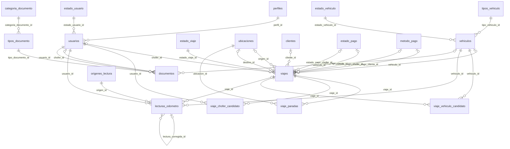

# DER — Adri-Mar Gestión Online (estado al cierre del Sprint 2)

Modelo de base de datos actual (PostgreSQL), **sin** el módulo de presupuestos (Sprint 3).
Son **20 tablas**. Los nombres son los reales de la base (tablas y columnas en `snake_case`).

## Cómo leer este documento

| Marca | Significado |
|---|---|
| **PK** | Clave primaria |
| **FK** → tabla | Clave foránea (a qué tabla apunta) |
| **UQ** | Valor único |
| **N** | Admite nulo (opcional). Si no dice N, es obligatorio |

Cardinalidades en la sección de relaciones: `1` = exactamente uno, `0..1` = cero o uno,
`N` = muchos. En Draw.io usá la notación pata de gallo (Crow's Foot): menú
*Entity Relation* → conectores "1 a N", "0..1 a N", etc.

Sugerencia de colores para agrupar en el diagrama: **Usuarios**, **Flota**, **Viajes**,
**Odómetro**, **Documentación** y **Catálogos** (las tablas chicas de `id` + `descripcion`).

---

## 1. Usuarios

### `usuarios`
| Columna | Tipo | Restricciones |
|---|---|---|
| id | INTEGER | **PK** |
| nombre | TEXT | |
| apellido | TEXT | |
| nombre_usuario | TEXT | **UQ** |
| contrasena_hash | TEXT | |
| perfil_id | INTEGER | **FK** → perfiles |
| dni | TEXT | **UQ**, N |
| email | TEXT | **UQ**, N |
| telefono | TEXT | N |
| estado_usuario_id | INTEGER | **FK** → estado_usuario |
| habilitado_para_conducir | BOOLEAN | default `false` |
| creado_en | TIMESTAMP | default now |

> Un chofer **no** es una tabla aparte: es un usuario con perfil CHOFER (o cualquier usuario con `habilitado_para_conducir = true`).

---

## 2. Flota

### `vehiculos`
| Columna | Tipo | Restricciones |
|---|---|---|
| id | INTEGER | **PK** |
| dominio | TEXT | **UQ** |
| numero_interno | TEXT | |
| marca | TEXT | |
| modelo | TEXT | |
| anio | INTEGER | |
| asientos | INTEGER | |
| kilometraje | INTEGER | |
| estado_vehiculo_id | INTEGER | **FK** → estado_vehiculo |
| tipo_vehiculo_id | INTEGER | **FK** → tipos_vehiculo |
| fecha_baja | TIMESTAMP | N |
| creado_en | TIMESTAMP | default now |

---

## 3. Viajes

### `viajes`
| Columna | Tipo | Restricciones |
|---|---|---|
| id | INTEGER | **PK** |
| chofer_id | INTEGER | **FK** → usuarios, N |
| vehiculo_id | INTEGER | **FK** → vehiculos, N |
| origen_id | INTEGER | **FK** → ubicaciones, N |
| destino_id | INTEGER | **FK** → ubicaciones, N |
| estado_viaje_id | INTEGER | **FK** → estado_viaje |
| fecha_inicio | TIMESTAMP | N |
| fecha_fin | TIMESTAMP | N |
| kilometros_estimados | INTEGER | N |
| cantidad_pasajeros | INTEGER | N |
| odometro_inicial | INTEGER | N |
| odometro_final | INTEGER | N |
| hora_inicio_real | TIMESTAMP | N |
| hora_fin_real | TIMESTAMP | N |
| observacion_final | TEXT | N |
| precio | DECIMAL(12,2) | N |
| cliente_id | INTEGER | **FK** → clientes, N |
| estado_pago_cliente_id | INTEGER | **FK** → estado_pago, N |
| fecha_pago_cliente | TIMESTAMP | N |
| metodo_pago_cliente_id | INTEGER | **FK** → metodo_pago, N |
| pago_chofer | DECIMAL(12,2) | N |
| estado_pago_chofer_id | INTEGER | **FK** → estado_pago, N |
| fecha_pago_chofer | TIMESTAMP | N |
| metodo_pago_chofer_id | INTEGER | **FK** → metodo_pago, N |
| creado_en | TIMESTAMP | default now |
| actualizado_en | TIMESTAMP | se actualiza solo |

> Chofer, vehículo y fechas son opcionales porque un viaje en estado A_CONFIRMAR todavía no los tiene. `viajes` tiene **dos FK a `ubicaciones`** (origen y destino), **dos FK a `estado_pago`** y **dos FK a `metodo_pago`** (una del cliente y otra del chofer): en el diagrama van como líneas separadas, cada una con su rol.

### `viaje_paradas`
Paradas intermedias ordenadas entre origen y destino.

| Columna | Tipo | Restricciones |
|---|---|---|
| id | INTEGER | **PK** |
| viaje_id | INTEGER | **FK** → viajes (se borra con el viaje) |
| ubicacion_id | INTEGER | **FK** → ubicaciones |
| orden | INTEGER | **UQ** junto con viaje_id |

### `viaje_chofer_candidato` (tabla intermedia N:M)
Choferes posibles mientras el viaje está A_CONFIRMAR. Al confirmar, se borran.

| Columna | Tipo | Restricciones |
|---|---|---|
| viaje_id | INTEGER | **PK** compuesta, **FK** → viajes |
| usuario_id | INTEGER | **PK** compuesta, **FK** → usuarios |

### `viaje_vehiculo_candidato` (tabla intermedia N:M)
| Columna | Tipo | Restricciones |
|---|---|---|
| viaje_id | INTEGER | **PK** compuesta, **FK** → viajes |
| vehiculo_id | INTEGER | **PK** compuesta, **FK** → vehiculos |

### `ubicaciones`
| Columna | Tipo | Restricciones |
|---|---|---|
| id | INTEGER | **PK** |
| nombre | TEXT | |
| nombre_normalizado | TEXT | **UQ** (evita duplicados tipo "Río Tercero" / "rio tercero") |
| creado_en | TIMESTAMP | default now |

### `clientes`
| Columna | Tipo | Restricciones |
|---|---|---|
| id | INTEGER | **PK** |
| nombre | TEXT | |
| nombre_normalizado | TEXT | **UQ** |
| creado_en | TIMESTAMP | default now |

---

## 4. Odómetro

### `lecturas_odometro`
Historial de lecturas de kilometraje de cada vehículo.

| Columna | Tipo | Restricciones |
|---|---|---|
| id | INTEGER | **PK** |
| vehiculo_id | INTEGER | **FK** → vehiculos |
| valor_km | INTEGER | |
| fecha_hora | TIMESTAMP | |
| origen_id | INTEGER | **FK** → origenes_lectura |
| viaje_id | INTEGER | **FK** → viajes, N |
| usuario_id | INTEGER | **FK** → usuarios (quién la registró) |
| lectura_corregida_id | INTEGER | **FK** → lecturas_odometro, N (**autorrelación**) |
| motivo | TEXT | N |
| creado_en | TIMESTAMP | default now |

> `lectura_corregida_id` apunta a otra fila de la misma tabla: una lectura de corrección indica qué lectura corrige. En Draw.io es una línea que sale y vuelve a la misma entidad.

---

## 5. Documentación

### `documentos`
Cada fila es una versión cargada de un documento. Pertenece a un vehículo **o** a un chofer, nunca a los dos.

| Columna | Tipo | Restricciones |
|---|---|---|
| id | INTEGER | **PK** |
| tipo_documento_id | INTEGER | **FK** → tipos_documento |
| vehiculo_id | INTEGER | **FK** → vehiculos, N |
| chofer_id | INTEGER | **FK** → usuarios, N |
| archivo_path | TEXT | N |
| nombre_archivo | TEXT | N |
| fecha_emision | TIMESTAMP | N |
| fecha_vencimiento | TIMESTAMP | N |
| observaciones | TEXT | N |
| usuario_id | INTEGER | **FK** → usuarios (quién lo cargó) |
| creado_en | TIMESTAMP | default now |

> Restricción CHECK `documentos_un_solo_titular`: exactamente uno de `vehiculo_id` o `chofer_id` tiene valor. `documentos` tiene **dos FK a `usuarios`** (el chofer titular y quien lo registró).

### `tipos_documento`
| Columna | Tipo | Restricciones |
|---|---|---|
| id_tipodocumento | INTEGER | **PK** |
| descripcion | TEXT | **UQ** |
| categoria_documento_id | INTEGER | **FK** → categoria_documento |
| requiere_vencimiento | BOOLEAN | |
| requiere_archivo | BOOLEAN | |
| dias_aviso | INTEGER | |

Valores: POLIZA_SEGURO, CERT_COBERTURA, PAGO_SEGURO, ITV, MATAFUEGOS, TITULO_VEHICULO, CEDULA_IDENTIFICACION, ALTA_TRANSPORTE (vehículo) · LICENCIA_CONDUCIR, DNI_CHOFER (chofer).

---

## 6. Catálogos

Todas tienen la misma forma: un id **PK** y `descripcion` TEXT **UQ** (tipos_vehiculo además tiene `orden`).

| Tabla | PK | Valores |
|---|---|---|
| `perfiles` | id_perfil | ADMINISTRADOR, ENCARGADO, PERSONAL_TALLER, CHOFER |
| `estado_usuario` | id_estadousuario | ACTIVO, INACTIVO |
| `tipos_vehiculo` | id_tipovehiculo | Colectivo, Minibus, Utilitario, etc. (+ columna `orden` INTEGER) |
| `estado_vehiculo` | id_estadovehiculo | OPERATIVO, EN_TALLER, DADO_DE_BAJA |
| `estado_viaje` | id_estadoviaje | A_CONFIRMAR, PROGRAMADO, EN_VIAJE, FINALIZADO, CANCELADO |
| `estado_pago` | id_estadopago | PENDIENTE, PAGADO, PARCIAL |
| `metodo_pago` | id_metodopago | EFECTIVO, BANCO, CHEQUE |
| `origenes_lectura` | id_origenlectura | ALTA_VEHICULO, INICIO_VIAJE, FIN_VIAJE, MANUAL, CORRECCION, MANTENIMIENTO |
| `categoria_documento` | id_categoriadocumento | VEHICULO, CHOFER |

---

## 7. Relaciones (para dibujar las líneas)

Formato: **tabla A (cardinalidad) — (cardinalidad) tabla B**, a través de qué FK.

### Usuarios y flota
| Desde | | Hacia | FK | Rol |
|---|---|---|---|---|
| perfiles 1 | — | N usuarios | usuarios.perfil_id | |
| estado_usuario 1 | — | N usuarios | usuarios.estado_usuario_id | |
| tipos_vehiculo 1 | — | N vehiculos | vehiculos.tipo_vehiculo_id | |
| estado_vehiculo 1 | — | N vehiculos | vehiculos.estado_vehiculo_id | |

### Viajes
| Desde | | Hacia | FK | Rol |
|---|---|---|---|---|
| usuarios 0..1 | — | N viajes | viajes.chofer_id | chofer asignado |
| vehiculos 0..1 | — | N viajes | viajes.vehiculo_id | vehículo asignado |
| estado_viaje 1 | — | N viajes | viajes.estado_viaje_id | |
| ubicaciones 0..1 | — | N viajes | viajes.origen_id | origen |
| ubicaciones 0..1 | — | N viajes | viajes.destino_id | destino |
| clientes 0..1 | — | N viajes | viajes.cliente_id | |
| estado_pago 0..1 | — | N viajes | viajes.estado_pago_cliente_id | pago del cliente |
| estado_pago 0..1 | — | N viajes | viajes.estado_pago_chofer_id | pago al chofer |
| metodo_pago 0..1 | — | N viajes | viajes.metodo_pago_cliente_id | pago del cliente |
| metodo_pago 0..1 | — | N viajes | viajes.metodo_pago_chofer_id | pago al chofer |
| viajes 1 | — | N viaje_paradas | viaje_paradas.viaje_id | |
| ubicaciones 1 | — | N viaje_paradas | viaje_paradas.ubicacion_id | |
| viajes 1 | — | N viaje_chofer_candidato | viaje_chofer_candidato.viaje_id | N:M viajes ↔ usuarios |
| usuarios 1 | — | N viaje_chofer_candidato | viaje_chofer_candidato.usuario_id | N:M viajes ↔ usuarios |
| viajes 1 | — | N viaje_vehiculo_candidato | viaje_vehiculo_candidato.viaje_id | N:M viajes ↔ vehiculos |
| vehiculos 1 | — | N viaje_vehiculo_candidato | viaje_vehiculo_candidato.vehiculo_id | N:M viajes ↔ vehiculos |

### Odómetro
| Desde | | Hacia | FK | Rol |
|---|---|---|---|---|
| vehiculos 1 | — | N lecturas_odometro | lecturas_odometro.vehiculo_id | |
| origenes_lectura 1 | — | N lecturas_odometro | lecturas_odometro.origen_id | |
| viajes 0..1 | — | N lecturas_odometro | lecturas_odometro.viaje_id | |
| usuarios 1 | — | N lecturas_odometro | lecturas_odometro.usuario_id | registró |
| lecturas_odometro 0..1 | — | N lecturas_odometro | lecturas_odometro.lectura_corregida_id | autorrelación: corrige a |

### Documentación
| Desde | | Hacia | FK | Rol |
|---|---|---|---|---|
| categoria_documento 1 | — | N tipos_documento | tipos_documento.categoria_documento_id | |
| tipos_documento 1 | — | N documentos | documentos.tipo_documento_id | |
| vehiculos 0..1 | — | N documentos | documentos.vehiculo_id | titular vehículo |
| usuarios 0..1 | — | N documentos | documentos.chofer_id | titular chofer |
| usuarios 1 | — | N documentos | documentos.usuario_id | registró |

**Total: 30 relaciones.** Si al terminar el diagrama les quedan menos líneas, falta alguna.

---

## 8. Vista previa (Mermaid)

Si lo abren en GitHub o en VS Code con extensión de Mermaid, esto se ve como diagrama y sirve para chequear el resultado. Para no saturarlo, acá van solo PK y FK.

