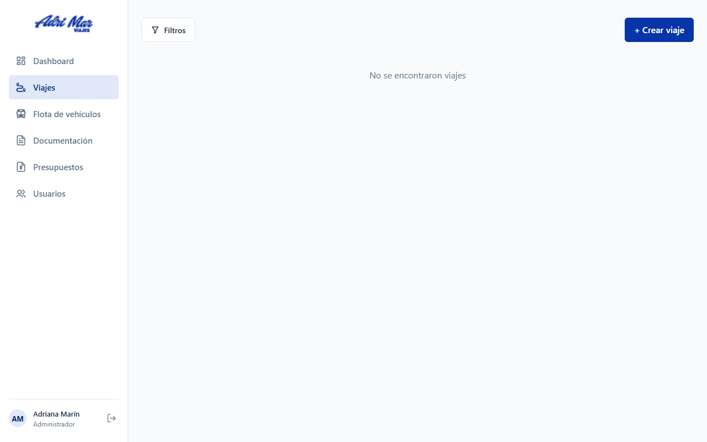

# Auditoría de UI/UX: Adri-Mar Gestión Online

Fecha: 19 oct 2026. Rama auditada: `fix/selector-y-tramo-sin-ruta` (commit `6b6a6e0`).

Es un diagnóstico, sin cambios en la app. Corrí backend y frontend contra una base PostgreSQL local con datos de prueba: 19 viajes en los cinco estados, con y sin paradas y con y sin datos administrativos, más 8 vehículos, documentación vigente, por vencer, vencida y faltante, 4 presupuestos, 7 clientes y 15 ubicaciones. Comparé lo que vi contra el design system del propio proyecto (`docs/design-system` y `frontend/src/components/ui`).

Cómo leer las gravedades:

- **Bloqueante:** hace que alguien tome una decisión equivocada o no pueda hacer su trabajo.
- **Alta:** genera errores o mucha fricción en una tarea frecuente.
- **Media:** genera inconsistencia o fricción que se nota, pero tiene solución alternativa.
- **Baja:** es pulido.

El esfuerzo se estima así: **chico** es menos de medio día, **mediano** es uno a tres días y **grande** es más que eso o necesita definir algo antes.

Las capturas están en [`capturas/`](capturas/) con el nombre `pantalla-estado-tamaño.png`. Junto a cada captura medí tres cosas automáticamente: scroll horizontal, controles de menos de 44 px y una pasada de axe-core (WCAG 2 A/AA).

---

## Resumen

1. **Si falla la red, Viajes, Flota, Mis viajes y el Dashboard del chofer dicen que no hay nada**, por ejemplo "No tenés viajes programados próximamente", en lugar de mostrar un error. El chofer puede creer que no tiene viajes.
2. **Un chofer con un viaje En viaje igual ve "Comenzar viaje" en sus otros viajes.** Recién se entera de que no puede después de cargar el odómetro.
3. **"Editar vehículo" deja cambiar el kilometraje, pero el backend lo ignora** y la pantalla dice "Cambios guardados correctamente."
4. **El listado de Viajes no ayuda a encontrar lo de hoy.** Muestra primero los viajes futuros, "Hoy" queda en el medio, no tiene paginación ni búsqueda y el cliente no aparece en la tarjeta.
5. **En el celular, la acción principal queda lejos y sin contexto.** En las fichas de viaje "Comenzar" y "Finalizar" están al final de una ficha larga. Los modales de confirmar viaje dejan los botones fuera de la pantalla.

---

## Problemas transversales

### T1. Los errores de carga se muestran como estados vacíos

Varias pantallas piden datos con `.then().finally()` y sin `.catch()`. Si el pedido falla, `cargando` pasa a `false`, la lista queda vacía y aparece el mensaje de "no hay datos". En la consola queda un `Network Error` sin capturar.

| Pantalla | Qué se ve con la red caída | Archivo |
| --- | --- | --- |
| Viajes | "No se encontraron viajes" | [Viajes.jsx:169-183](../../frontend/src/pages/Viajes.jsx#L169-L183) |
| Flota | "No se encontraron vehículos" | [FlotaVehiculos.jsx:84-87](../../frontend/src/pages/FlotaVehiculos.jsx#L84-L87) |
| Mis viajes | "No tenés viajes asignados" | [MisViajes.jsx:66-80](../../frontend/src/pages/MisViajes.jsx#L66-L80) |
| Dashboard (chofer) | "No tenés viajes programados próximamente", y desaparece la tarjeta del viaje en curso | [Dashboard.jsx:159-169](../../frontend/src/pages/Dashboard.jsx#L159-L169) |

Las demás pantallas sí lo resuelven bien: los paneles del Dashboard de gestión, Documentación y Presupuestos muestran un `Alert` de error ([dashboard-error-red-admin-escritorio.png](capturas/dashboard-error-red-admin-escritorio.png), [documentacion-error-red-escritorio.png](capturas/documentacion-error-red-escritorio.png)). El patrón correcto ya está en el código, pero no se aplica en todas partes. Ningún error de carga ofrece "Reintentar".



### T2. El feedback aparece lejos de donde se actuó

- Los errores de acciones van en un `Alert` arriba de todo, encima de "← Volver al listado". Pasa con "No se pudo cancelar el viaje" ([viajes-cancelar-error-red-escritorio.png](capturas/viajes-cancelar-error-red-escritorio.png)) y con "No se pudo generar el enlace al archivo" en Documentación ([documentacion-ver-pdf-error-celular.png](capturas/documentacion-ver-pdf-error-celular.png)). En el celular, quien tocó "Ver PDF" en el quinto documento no ve el mensaje, y el mensaje no dice de qué documento se trata.
- Después de guardar, el destino depende de la pantalla:

| Acción | Adónde lleva |
| --- | --- |
| Crear viaje | A la ficha nueva |
| Crear presupuesto | A la ficha nueva |
| Editar viaje | Al listado |
| Crear vehículo | Al listado. El vehículo nuevo queda fuera de la vista ([flota-crear-exito-escritorio.png](capturas/flota-crear-exito-escritorio.png)) |
| Editar vehículo | Al listado |
| Cancelar una edición | Al listado, no a la ficha de la que salió. La excepción es Duplicar viaje, que sí vuelve "al viaje" |

- Los textos de éxito no siguen un criterio único:
  - Unos llevan punto final y otros no: "Viaje creado como A confirmar" frente a "Cambios guardados correctamente."
  - Cambia el verbo: "Vehículo registrado correctamente." frente a "Presupuesto creado correctamente.", cuando el botón dice "Crear vehículo".

### T3. Botones y acciones con reglas distintas en cada pantalla

- **Dónde van las acciones de una ficha:**
  - En Viaje, debajo de la card, con "Duplicar viaje" en una fila aparte.
  - En Vehículo y en Presupuesto, dentro de la card.
  - En Documentación, en cada tarjeta.

  El propio design system tiene las dos variantes (FichaDetalle: vehículo adentro, viaje afuera).
- **Orden de los botones:**
  - En los formularios va primero el primario: "Crear viaje" y después "Cancelar".
  - En los modales va primero el secundario: "Cancelar" y después "Guardar".

  El README de `Button` dice "en pares, el secundario va primero". Hoy los formularios no lo cumplen.
- **Peso visual:** en la ficha de un viaje Programado hay cinco botones en fila. "Cancelar viaje" es un botón rojo sólido con el mismo peso que "Comenzar viaje" ([viajes-ficha-programado-escritorio.png](capturas/viajes-ficha-programado-escritorio.png)).
- **Etiquetas:** "Guardar datos" (datos administrativos), "Guardar" (documentos) y "Guardar cambios" (viaje y vehículo) hacen lo mismo con tres textos distintos.

### T4. El `h1` de las fichas cambia según desde dónde se entra

| Pantalla | `h1` |
| --- | --- |
| Viajes, viaje con chofer | "Viaje de Martín Gómez" |
| Viajes, viaje sin chofer | "Viaje a confirmar" |
| Mis viajes (chofer y también encargado) | "12 - AE452KD" (el vehículo) |
| Flota | "Vehículo 12 - AE452KD" |
| Documentación | "12 - AE452KD" (sin "Vehículo") |
| Presupuesto | "Presupuesto para Turismo Sierras SRL" |

El mismo viaje tiene dos títulos distintos según la sección. Ninguno de los dos dice lo que identifica al viaje: el recorrido, la fecha y el cliente. El badge de estado también se mueve: en Viajes y Flota va a la derecha y en Documentación va pegado al título.

### T5. Textos para "no hay dato" y "no hay resultados"

- **Dato vacío:** el design system manda "No registrado", pero conviven tres variantes:
  - "No registrado" en la ficha del viaje.
  - "No cargado" en los datos administrativos ([DatosAdministrativosViaje.jsx:12](../../frontend/src/components/DatosAdministrativosViaje.jsx#L12)).
  - "Sin cargar" para candidatos vacíos.
- **Listado vacío:** el design system propone "No hay viajes con esos filtros.", pero hay cinco formas distintas:
  - "No se encontraron viajes" (sin punto).
  - "No se encontraron vehículos" (sin punto).
  - "No se encontraron vehículos." (con punto, en Documentación).
  - "No hay presupuestos para ese cliente."
  - "No tenés viajes asignados". Este aparece también cuando el chofer filtró por Cancelado, y es falso ([mis-viajes-vacio-chofer-celular.png](capturas/mis-viajes-vacio-chofer-celular.png)).
- **Limpiar filtros:** ningún estado vacío con filtros ofrece "Limpiar filtros", y el panel de filtros tampoco tiene ese botón.
- **Fechas:** el design system prohíbe "dd/mm/aaaa", pero aparece en dos lugares:
  - El modal de cancelar dice "del 20/10/2026, 10:00 p. m." (además usa formato de 12 horas).
  - El PDF del presupuesto usa "08/10/2026".

### T6. Validación en dos vueltas

El front valida solo una parte de los campos y el resto lo valida el backend, así que los errores aparecen de a tandas:

- **Crear viaje:** al enviar vacío solo marca "Fecha y hora de inicio" ([viajes-alta-errores-escritorio.png](capturas/viajes-alta-errores-escritorio.png)). Con la fecha cargada aparecen recién Cliente, Origen y Destino ([viajes-alta-errores-segunda-ronda-escritorio.png](capturas/viajes-alta-errores-segunda-ronda-escritorio.png)). Los cuatro campos tienen el asterisco desde el principio.
- **Crear vehículo:** el kilometraje se valida en una segunda pasada del backend ([vehiculoService.js](../../backend/src/services/vehiculoService.js), `validarKilometrajeInicial`). Marca está marcada como obligatoria, pero el error aparece en Modelo. El año 1890 se acepta sin aviso ([flota-alta-errores-escritorio.png](capturas/flota-alta-errores-escritorio.png)).
- **Contraejemplo:** Crear presupuesto muestra todos los errores juntos ([presupuestos-alta-errores-escritorio.png](capturas/presupuestos-alta-errores-escritorio.png)). Es el comportamiento a copiar.
- **Foco:** en ningún formulario se lleva el foco ni el scroll al primer error.

### T7. En el celular, la acción principal queda al final

- **Fichas:** las de viaje y vehículo ponen las acciones después de todos los datos. En Mis viajes, "Finalizar viaje" queda debajo de 12 datos ([mis-viajes-ficha-en-viaje-chofer-celular.png](capturas/mis-viajes-ficha-en-viaje-chofer-celular.png)).
- **Botonera de la ficha de viaje:** a 390 px se parte en cuatro filas desparejas ([viajes-ficha-programado-celular.png](capturas/viajes-ficha-programado-celular.png)).
- **Modal Confirmar viaje:** no entra ni en el celular ni a 1280 × 800, y los botones quedan abajo, fuera de la vista ([viajes-modal-confirmar-celular.png](capturas/viajes-modal-confirmar-celular.png), [viajes-modal-confirmar-falta-fin-escritorio.png](capturas/viajes-modal-confirmar-falta-fin-escritorio.png)). El design system lo admite ("scrollea por dentro"), pero no hay ninguna señal de que hay más abajo.
- **Ruta en tarjetas:** con el badge al lado, la ruta queda en dos o tres líneas, con la flecha colgando al final de la primera. "· 1 parada" queda solo en una línea, empezando con el punto ([dashboard-chofer-celular.png](capturas/dashboard-chofer-celular.png), [mis-viajes-listado-chofer-celular.png](capturas/mis-viajes-listado-chofer-celular.png)).

### T8. El design system está desactualizado respecto del código

- **Datos administrativos:** `FormularioViaje.md` dice que van en una sección colapsada del formulario. Hoy se cargan desde la ficha ([ViajeForm.jsx:91-93](../../frontend/src/components/ViajeForm.jsx#L91-L93)).
- **Presupuestos:** `Navegacion.md` no lista Presupuestos. No hay patrón documentado para su listado, ficha, formulario ni PDF, así que la pantalla más nueva quedó sin referencia y por eso difiere (ver P-Presupuestos).
- **Estado del sistema:** el README dice "El código (rama `feat/ux-viajes-v3`) implementa este sistema completo". Ya no es así.

---

## Por pantalla

Cada hallazgo tiene un código para poder citarlo en el plan.

### Login

**L1. La card salta al aparecer un error.** Gravedad baja, esfuerzo chico.
- **Captura:** [login-escritorio.png](capturas/login-escritorio.png) y [login-vacio-escritorio.png](capturas/login-vacio-escritorio.png).
- **Qué pasa:** la card está centrada en vertical. El `Alert` la agranda y todo el formulario sube unos 30 px.
- **Por qué importa:** el puntero o el dedo queda sobre otro lugar justo cuando el usuario quiere reintentar.
- **Propuesta:** alinear la card arriba con un margen fijo, o reservar el espacio del mensaje.

**L2. La validación con campos vacíos es genérica.** Gravedad baja, esfuerzo chico.
- **Qué pasa:** con los campos vacíos sale "Usuario y contraseña son obligatorios" en un `Alert`, sin marcar cuál falta. Los campos no llevan asterisco.
- **Propuesta:** marcar el error en cada `FormField`, que es el patrón de la app. El `Alert` queda para "Usuario o contraseña incorrectos".

### Dashboard

**D1. Personal de Taller ve un Dashboard vacío.** Gravedad alta, esfuerzo mediano.
- **Captura:** [dashboard-taller-escritorio.png](capturas/dashboard-taller-escritorio.png).
- **Qué pasa:** la pantalla solo muestra "Hola, Raúl".
- **Por qué importa:** es la primera pantalla del perfil y no le sirve para nada. Tampoco tiene acciones en el resto de la app: no puede pasar un vehículo a En taller ni registrar una lectura de odómetro, porque no hay pantalla para eso (el backend no expone un cambio de estado del vehículo).
- **Propuesta:** como mínimo, un panel "Vehículos en taller" y "Viajes de hoy" en solo lectura (qué unidades salen hoy). Definir con el negocio qué tiene que poder *hacer* este perfil, porque el módulo de mantenimiento está pendiente (SCRUM-34).

**D2. Un chofer con un viaje En viaje ve "Comenzar viaje" en todos sus próximos viajes.** Gravedad alta, esfuerzo chico.
- **Captura:** [dashboard-chofer-celular.png](capturas/dashboard-chofer-celular.png) y [mis-viajes-modal-comenzar-error-celular.png](capturas/mis-viajes-modal-comenzar-error-celular.png).
- **Qué pasa:** el botón está activo. Al tocarlo y cargar el odómetro, el backend responde "El chofer ya tiene otro viaje En viaje en curso".
- **Por qué importa:** el chofer pierde lo que cargó y el mensaje repite "viaje En viaje en curso". Pasa lo mismo en la ficha de Mis viajes.
- **Propuesta:** con un viaje En viaje, deshabilitar "Comenzar viaje" con un texto visible debajo, como hace `AvisarPorWhatsApp`: "Finalizá el viaje en curso para comenzar otro". Reescribir el mensaje del backend como "Ya tenés un viaje en curso".

**D3. Los viajes atrasados no aparecen para los gestores y para el chofer figuran como "próximos".** Gravedad media, esfuerzo mediano.
- **Captura:** [dashboard-admin-escritorio.png](capturas/dashboard-admin-escritorio.png) y [dashboard-chofer-viaje-atrasado-celular.png](capturas/dashboard-chofer-viaje-atrasado-celular.png).
- **Qué pasa:** el viaje de ayer, todavía Programado (Río Tercero → Santa Rosa de Calamuchita), no está en ningún panel de gestión. Para Ana sale primero en "Tus próximos viajes", con fecha 18 oct.
- **Por qué importa:** nadie se entera de que un viaje quedó sin comenzar ni cerrar. Respeto la decisión del design system de no marcar el atraso con color ni badge, pero eso no implica ocultarlo.
- **Propuesta:**
  - Sumar al Dashboard de gestión un grupo "Sin cerrar" dentro de "Viajes de hoy", en texto gris y sin badge nuevo, con los Programados y En viaje de días anteriores.
  - Para el chofer, renombrar el panel a "Tus viajes pendientes", o separar "Ayer · dom 18 oct" con el mismo título de día del listado.

**D4. El Dashboard de gestión no tiene una acción principal.** Gravedad baja, esfuerzo chico.
- **Qué pasa:** la tarea más común (crear un viaje) obliga a ir primero a Viajes.
- **Propuesta:** un botón "Crear viaje" junto al saludo, solo para Administrador y Encargado.

**D5. Para un Encargado que conduce, "Tus próximos viajes" va antes que la operación.** Gravedad baja, esfuerzo chico.
- **Captura:** [dashboard-encargado-escritorio.png](capturas/dashboard-encargado-escritorio.png).
- **Qué pasa:** se respeta el orden documentado, pero ese perfil gestiona más de lo que maneja.
- **Propuesta:** para gestores, poner lo propio después de "Viajes de hoy", o como una fila compacta.

**D6. Los mensajes de error de los paneles no siguen un mismo formato.** Gravedad baja, esfuerzo chico.
- **Qué pasa:** "No se pudieron cargar los viajes de hoy." lleva punto y "No se pudieron cargar los viajes por confirmar" no. Ninguno tiene "Reintentar".

### Viajes: listado y filtros

**V1. El orden y la falta de búsqueda hacen difícil encontrar un viaje.** Gravedad alta, esfuerzo mediano.
- **Captura:** [viajes-listado-escritorio.png](capturas/viajes-listado-escritorio.png) y [viajes-listado-celular.png](capturas/viajes-listado-celular.png).
- **Qué pasa:**
  - El listado va del más futuro al más viejo, sin paginación: 30 oct arriba, "Hoy" en el medio y "Sin fecha" al final.
  - No hay buscador. Es el único listado de gestión sin uno, mientras Flota, Documentación y Presupuestos sí lo tienen.
  - La tarjeta no muestra el cliente, que es el primer dato de la ficha y del formulario.
- **Por qué importa:** con un año de viajes, para ver hoy hay que bajar por todos los futuros, y para encontrar "el viaje del Colegio" hay que abrir uno por uno.
- **Propuesta:**
  - Abrir por defecto en "desde hoy", con orden ascendente, y llevar el historial a un filtro o a un `ControlSegmentado` "Próximos | Anteriores".
  - Sumar un buscador por cliente o lugar, igual que en Presupuestos.
  - Mostrar el cliente en el sub: "07:30 – 10:00 · Martín Gómez · Fábrica Militar".

**V2. El badge "Sin precio" o "Cobro pendiente" ensucia el listado.** Gravedad media, esfuerzo chico.
- **Captura:** [viajes-listado-escritorio.png](capturas/viajes-listado-escritorio.png).
- **Qué pasa:** casi todas las tarjetas tienen un segundo badge amarillo, también los viajes A confirmar y los Finalizados.
- **Por qué importa:** usa el mismo amarillo que "En viaje" y "Por vencer", y compite con el estado. El design system pide "pocos colores fuera de los EstadoBadge".
- **Propuesta:** pasarlo al pie como texto gris ("Sin precio"), o mostrarlo solo con el filtro "Administrativo pendiente" activo.

**V3. Los filtros tienen jerga y les falta "Limpiar".** Gravedad media, esfuerzo chico.
- **Captura:** [viajes-filtros-celular.png](capturas/viajes-filtros-celular.png) y [viajes-listado-vacio-escritorio.png](capturas/viajes-listado-vacio-escritorio.png).
- **Qué pasa:**
  - Hay un filtro "Administrativo" con las opciones "Todos" y "Administrativo pendiente".
  - En el celular, los seis filtros ocupan toda la pantalla.
  - No hay "Limpiar filtros".
  - El estado vacío dice "No se encontraron viajes" aunque haya filtros activos.
- **Propuesta:**
  - Renombrar el filtro a "Cobro" con la opción "Sin precio o cobro pendiente".
  - Agregar "Limpiar filtros" en el panel y en el estado vacío ("No hay viajes con esos filtros. Limpiar filtros").
  - En el celular, cerrar el panel al elegir un filtro.

**V4. Personal de Taller ve "No registrado" en datos que sí existen.** Gravedad baja, esfuerzo chico.
- **Captura:** [viajes-ficha-a-confirmar-taller-escritorio.png](capturas/viajes-ficha-a-confirmar-taller-escritorio.png).
- **Qué pasa:** en un viaje A confirmar, "Choferes posibles" y "Vehículos posibles" dicen "No registrado" porque el perfil no puede verlos.
- **Por qué importa:** parece que faltan datos.
- **Propuesta:** no mostrar esas filas a quien no puede verlas.

### Viajes: ficha en cada estado

**V5. La botonera de la ficha no tiene jerarquía.** Gravedad media, esfuerzo mediano.
- **Captura:** [viajes-ficha-programado-escritorio.png](capturas/viajes-ficha-programado-escritorio.png), [viajes-ficha-a-confirmar-escritorio.png](capturas/viajes-ficha-a-confirmar-escritorio.png) y [viajes-ficha-programado-celular.png](capturas/viajes-ficha-programado-celular.png).
- **Qué pasa:**
  - Un viaje Programado muestra en fila Comenzar, Avisar por WhatsApp, Editar y "Cancelar viaje" (rojo sólido), y debajo, solo, "Duplicar viaje".
  - En el celular quedan cuatro filas sin orden.
  - Si el chofer no tiene teléfono, el texto de ayuda de WhatsApp desalinea la fila ([viajes-ficha-programado-sin-telefono-escritorio.png](capturas/viajes-ficha-programado-sin-telefono-escritorio.png)).
- **Propuesta:**
  - Dejar una acción primaria por estado: Confirmar, Comenzar o Finalizar.
  - Dejar Avisar y Editar como secundarias.
  - Agrupar "Duplicar viaje" y "Cancelar viaje" en un tercer nivel: `ghost`, o un menú "Más acciones". Cancelar abre igual el modal de confirmación.
  - En el celular, poner las acciones arriba de los datos, o en una barra fija abajo.

**V6. El título de la ficha no identifica el viaje.** Gravedad media, esfuerzo chico.
- **Qué pasa:** ver T4.
- **Propuesta:** usar como `h1` la ruta ("Río Tercero → Mendoza") y como subtítulo la fecha y el cliente ("mar 20 oct · Club Atlético Estudiantes"). Usar el mismo título en Viajes y en Mis viajes.

**V7. "Ver recorrido en Google Maps" queda flotando a mitad de la línea de tiempo.** Gravedad baja, esfuerzo chico.
- **Captura:** [viajes-ficha-finalizado-escritorio.png](capturas/viajes-ficha-finalizado-escritorio.png).
- **Qué pasa:** en escritorio el botón queda centrado en vertical al costado del recorrido. `RutaViaje.md` dice que va debajo.
- **Propuesta:** ponerlo debajo, como en el celular y en el formulario.

**V8. Los datos administrativos ocupan mucho cuando están vacíos.** Gravedad baja, esfuerzo chico.
- **Captura:** [viajes-ficha-cancelado-escritorio.png](capturas/viajes-ficha-cancelado-escritorio.png) y [viajes-ficha-historico-sin-recorrido-escritorio.png](capturas/viajes-ficha-historico-sin-recorrido-escritorio.png).
- **Qué pasa:** se repite ocho veces "No cargado".
- **Propuesta:** si no hay ningún dato, mostrar una línea ("Todavía no se cargaron el precio ni los pagos") con el botón "Cargar datos administrativos". Unificar "No cargado" con "No registrado" (ver T5).

### Viajes: modales

**V9. El modal "Confirmar viaje" no dice qué viaje está confirmando ni avisa de la documentación.** Gravedad media, esfuerzo mediano.
- **Captura:** [viajes-modal-confirmar-celular.png](capturas/viajes-modal-confirmar-celular.png) y [viajes-modal-confirmar-falta-fin-escritorio.png](capturas/viajes-modal-confirmar-falta-fin-escritorio.png).
- **Qué pasa:**
  - El modal se titula "Confirmar viaje", sin ruta, fecha ni cliente. Desde el panel del Dashboard no queda claro cuál se está confirmando.
  - Entre los choferes elegibles está Jorge López, con la licencia vencida hace 19 días, sin ningún aviso. Solo se avisa si el chofer se superpone con otro viaje o está dado de baja.
  - Los botones quedan fuera de la vista.
- **Propuesta:**
  - Poner ruta, fecha y cliente como subtítulo.
  - Sumar a los avisos de disponibilidad "Licencia vencida" y "Documentación vencida" (del vehículo), en el mismo tono informativo y sin bloquear.
  - Dejar los botones fijos al pie del modal.

**V10. El modal de cancelar tiene "Cancelar" y "Cancelar viaje" juntos.** Gravedad media, esfuerzo chico.
- **Captura:** [viajes-modal-cancelar-celular.png](capturas/viajes-modal-cancelar-celular.png).
- **Qué pasa:**
  - Son dos botones casi iguales con efectos opuestos.
  - El título no es una pregunta: el README de `ConfirmModal` propone "¿Cancelar este viaje?".
  - La fecha sale como "20/10/2026, 10:00 p. m.".
- **Propuesta:**
  - Usar "Volver" o "No cancelar" para el botón secundario de este modal, y lo mismo en "Dar de baja" de Flota.
  - Formatear la fecha con `formatearDiaYHora`.

### Viajes: alta, edición, duplicar y datos administrativos

**V11. La validación del alta va en dos tandas.** Gravedad alta, esfuerzo chico.
- **Qué pasa:** ver T6.
- **Propuesta:**
  - Validar en el front Cliente, Origen, Destino y Fecha de inicio juntos, como hace `PresupuestoForm`.
  - Llevar el foco al primer campo con error.
  - Unificar los textos ("Obligatorio para un viaje Programado." frente a "La fecha y hora de inicio es obligatoria").

**V12. Guardar o cancelar una edición vuelve al listado.** Gravedad media, esfuerzo chico.
- **Captura:** [viajes-editar-exito-vuelve-al-listado-escritorio.png](capturas/viajes-editar-exito-vuelve-al-listado-escritorio.png).
- **Qué pasa:** el usuario editó un viaje y no ve cómo quedó. Tiene que buscarlo de nuevo en un listado sin buscador (V1).
- **Propuesta:** volver a la ficha del viaje editado, con el toast. Así ya se hace al crear.

**V13. Al editar un viaje Programado, los selects de chofer y vehículo no avisan disponibilidad.** Gravedad media, esfuerzo mediano.
- **Captura:** [viajes-editar-programado-escritorio.png](capturas/viajes-editar-programado-escritorio.png) y [viajes-editar-a-confirmar-escritorio.png](capturas/viajes-editar-a-confirmar-escritorio.png).
- **Qué pasa:** en un A confirmar, los chips avisan "Vehículo en taller" o "Usuario dado de baja". En un Programado, el `select` lista a todos sin aviso y el conflicto aparece recién al guardar, como error del backend.
- **Por qué importa:** el vehículo sale como "2 - AB123CD", sin marca, y en el resto de la app lleva "· Mercedes-Benz O500".
- **Propuesta:** reutilizar `consultarDisponibilidad` y mostrar el motivo en la opción, como en el `select` "Elegir otro…" del modal Confirmar.

**V14. Los montos se cargan distinto en datos administrativos y en presupuestos.** Gravedad media, esfuerzo chico.
- **Captura:** [viajes-datos-administrativos-error-escritorio.png](capturas/viajes-datos-administrativos-error-escritorio.png) y [presupuestos-alta-escritorio.png](capturas/presupuestos-alta-escritorio.png).
- **Qué pasa:**
  - "Precio ($)" es un `type=number` sin separador de miles.
  - "Importe total" del presupuesto es texto con formato es-AR y muestra el valor formateado debajo ("Por ejemplo 420.000 o 420.000,50").
  - El botón dice "Guardar datos".
- **Propuesta:** usar el mismo campo de importe en los dos lugares y "Guardar cambios".

**V15. El aviso de Duplicar viaje funciona bien.** Gravedad: no es un problema.
- **Captura:** [viajes-duplicar-escritorio.png](capturas/viajes-duplicar-escritorio.png).
- **Qué hace:** "Duplicado del viaje del 15 oct 2026 a Córdoba. Elegí la fecha nueva y revisá pasajeros y unidad antes de crear." Es claro y "← Volver al viaje" lleva al lugar correcto. Conviene conservarlo (ver "Lo que está bien").

### Mis viajes (chofer)

**M1. El viaje en curso no aparece primero.** Gravedad alta, esfuerzo chico.
- **Captura:** [mis-viajes-listado-chofer-celular.png](capturas/mis-viajes-listado-chofer-celular.png).
- **Qué pasa:** el listado va del más futuro al más viejo. El viaje En viaje queda tercero, detrás del 27 oct y del 20 oct. El Dashboard del chofer ordena al revés (el más próximo arriba).
- **Propuesta:** en Mis viajes, poner arriba de todo el viaje En viaje y después los Programados en orden ascendente, igual que el Dashboard. Llevar Finalizados y Cancelados a "Anteriores".

**M2. En el celular, la acción principal queda al final de la ficha.** Gravedad alta, esfuerzo mediano.
- **Captura:** [mis-viajes-ficha-en-viaje-chofer-celular.png](capturas/mis-viajes-ficha-en-viaje-chofer-celular.png).
- **Qué pasa:** ver T7. Además, el chofer ve su propio nombre en "Chofer".
- **Propuesta:**
  - Poner "Finalizar viaje" o "Comenzar viaje" en una barra fija al pie (44 px o más, a todo el ancho) o arriba de los datos.
  - Para el chofer, no mostrar el par Chofer.

**M3. Las acciones de una ficha dependen de por dónde se entró.** Gravedad baja, esfuerzo chico.
- **Captura:** [mis-viajes-ficha-encargado-escritorio.png](capturas/mis-viajes-ficha-encargado-escritorio.png).
- **Qué pasa:** una Encargada que también conduce, al abrir su viaje en Mis viajes, solo ve "Comenzar viaje". En Viajes, el mismo viaje tiene Editar, Avisar y Cancelar. El `h1` también cambia.
- **Propuesta:** usar la misma ficha con las mismas acciones según el perfil, entre por donde entre.

**M4. "Comenzar el viaje" y "Finalizar el viaje" están bien resueltos.** Gravedad: no es un problema.
- **Captura:** [mis-viajes-modal-comenzar-celular.png](capturas/mis-viajes-modal-comenzar-celular.png) y [mis-viajes-modal-finalizar-celular.png](capturas/mis-viajes-modal-finalizar-celular.png).
- **Qué hacen:** "Último odómetro registrado: 412.300 km" da la referencia justa y los botones son grandes. El único detalle es el mensaje de error de D2.

### Flota: listado, ficha, alta y edición

**F1. El kilometraje parece editable, pero no se guarda.** Gravedad alta, esfuerzo chico.
- **Captura:** [flota-editar-escritorio.png](capturas/flota-editar-escritorio.png).
- **Qué pasa:** "Kilometraje actual" está habilitado al editar. El backend lo ignora y devuelve `avisos.kilometraje`: "El kilometraje no se modifica desde este formulario; se gestiona como historial de lecturas del odómetro." El front no lee ese aviso y muestra "Cambios guardados correctamente." Lo verifiqué contra la API local: el valor sigue en 157.345 km.
- **Propuesta:** al editar, mostrar el kilometraje como dato de solo lectura con el hint "Se actualiza con las lecturas del odómetro". A mediano plazo, sumar una pantalla de lecturas.

**F2. Las validaciones del alta están incompletas o mal ubicadas.** Gravedad media, esfuerzo chico.
- **Captura:** [flota-alta-errores-escritorio.png](capturas/flota-alta-errores-escritorio.png).
- **Qué pasa:**
  - Marca tiene asterisco, pero su error sale en Modelo ("El modelo es obligatorio").
  - El año 1890 y 0 asientos se aceptan.
  - El kilometraje se valida en una segunda vuelta.
- **Propuesta:** "Elegí la marca" en Marca, rangos razonables para año y asientos, y todo validado de una vez.

**F3. Después de crear un vehículo, no se ve el vehículo creado.** Gravedad baja, esfuerzo chico.
- **Captura:** [flota-crear-exito-escritorio.png](capturas/flota-crear-exito-escritorio.png).
- **Qué pasa:** el toast aparece sobre el listado y el interno 30 queda abajo de todo.
- **Propuesta:** abrir la ficha del vehículo nuevo, como en Viajes y Presupuestos, con un acceso a "Cargar documentación".

**F4. Flota y Documentación van en un solo sentido.** Gravedad baja, esfuerzo chico.
- **Captura:** [flota-ficha-celular.png](capturas/flota-ficha-celular.png) y [documentacion-ficha-vehiculo-escritorio.png](capturas/documentacion-ficha-vehiculo-escritorio.png).
- **Qué pasa:**
  - La ficha del vehículo tiene "Ver documentación", pero la de Documentación no tiene "Ver vehículo".
  - El listado de Flota no muestra el estado de la documentación, que es lo que más se consulta de un vehículo.
- **Propuesta:** un enlace de vuelta y, en la tarjeta de Flota, el estado de la documentación en el pie ("Documentación vencida").

**F5. "Dar de baja" está tan a mano como "Editar".** Gravedad baja, esfuerzo chico.
- **Qué pasa:** el botón rojo sólido de una acción irreversible está al lado de Editar (ver T3).
- **Propuesta:** el mismo criterio que V5.

### Documentación: listado y fichas

**DOC1. "Actualizar" sin cambios crea una versión duplicada y puede borrar el historial.** Gravedad alta, esfuerzo chico.
- **Captura:** [documentacion-modal-actualizar-escritorio.png](capturas/documentacion-modal-actualizar-escritorio.png) y [documentacion-actualizar-sin-cambios-guardado-celular.png](capturas/documentacion-actualizar-sin-cambios-guardado-celular.png).
- **Qué pasa:** el modal llega con las fechas actuales precargadas y "si no adjuntás uno nuevo, se mantiene el PDF actual". Apretar "Guardar" sin tocar nada guarda una versión idéntica: "Documento guardado correctamente.". Como se conservan solo tres versiones, la más vieja se purga. Me pasó durante la auditoría.
- **Propuesta:**
  - Deshabilitar "Guardar" hasta que cambie algo (archivo o fechas).
  - Llamar a la acción "Renovar" y pedir el PDF nuevo como obligatorio cuando el tipo lo requiere.
  - Para corregir solo una fecha, ofrecer "Corregir fechas", que no cree una versión nueva.

**DOC2. El error de "Ver PDF" aparece arriba de todo y no dice de qué documento es.** Gravedad media, esfuerzo chico.
- **Qué pasa:** ver T2.
- **Propuesta:** mostrar el error en la tarjeta del documento ("No se pudo abrir el PDF de la Póliza de seguro. Intentá de nuevo.") o en un toast con acción "Reintentar".

**DOC3. El encabezado de la ficha no sigue el patrón de las demás fichas.** Gravedad baja, esfuerzo chico.
- **Qué pasa:** el título dice "12 - AE452KD" sin "Vehículo" y el badge va pegado al título (ver T4).
- **Propuesta:** el mismo encabezado que la ficha de Flota.

**DOC4. Listado y ficha cumplen bien su función.** Gravedad: no es un problema.
- **Captura:** [documentacion-listado-vehiculos-escritorio.png](capturas/documentacion-listado-vehiculos-escritorio.png) y [documentacion-ficha-vehiculo-sin-documentos-escritorio.png](capturas/documentacion-ficha-vehiculo-sin-documentos-escritorio.png).
- **Qué hacen:** la línea de detalle ("Faltan 2: …", "ITV venció el 02 oct") permite priorizar sin abrir la ficha. Un vehículo sin nada cargado muestra "Cargar documento" como primario en cada tarjeta. El historial es claro ([documentacion-modal-historial-escritorio.png](capturas/documentacion-modal-historial-escritorio.png)). El único detalle: con ocho "Vigente" verdes seguidos, el que importa se pierde. Se podrían ordenar los documentos por urgencia dentro de cada sección.

### Presupuestos: listado, alta y PDF

**P1. Los presupuestos no tienen estado.** Gravedad media, esfuerzo mediano.
- **Captura:** [presupuestos-listado-escritorio.png](capturas/presupuestos-listado-escritorio.png).
- **Qué pasa:** el del Club Atlético venció el 16 oct y el del Colegio San José tenía el servicio hoy, pero todos se ven iguales. No hay forma de saber si se convirtió en un viaje.
- **Propuesta:**
  - Sumar un `EstadoBadge` con estado derivado: Vigente (success) o Vencido (neutral, a la altura de "Vence el 13 nov 2026").
  - Más adelante, "Crear viaje desde este presupuesto", que abra el alta precargada como Duplicar viaje.

**P2. La ficha y el formulario no siguen los patrones de Viajes.** Gravedad media, esfuerzo mediano.
- **Captura:** [presupuestos-ficha-con-factura-escritorio.png](capturas/presupuestos-ficha-con-factura-escritorio.png) y [presupuestos-alta-celular.png](capturas/presupuestos-alta-celular.png).
- **Qué pasa:**
  - Origen y destino van sueltos y sin paradas, cuando en el viaje son un "Recorrido".
  - El formulario empieza por "Fecha de emisión", que casi nunca se cambia, y el cliente va segundo.
  - El hint "Vacío = A confirmar" usa notación en lugar de una frase.
  - "Forma de pago" viene precargado en mayúsculas ("EFECTIVO / TRANSFERENCIA BANCARIA…").
- **Propuesta:**
  - Empezar por Cliente y llevar Fecha de emisión y Validez al final, juntos.
  - Usar el hint "Si lo dejás vacío, sale «A confirmar»".
  - Precargar la forma de pago en sentence case.
  - Documentar el patrón en el design system.

**P3. El PDF usa otra paleta y otro formato de fecha.** Gravedad baja, esfuerzo chico.
- **Captura:** [presupuestos-pdf-con-factura.png](capturas/presupuestos-pdf-con-factura.png) y [presupuestos-pdf-con-recibo-dos-unidades.png](capturas/presupuestos-pdf-con-recibo-dos-unidades.png).
- **Qué pasa:**
  - Hay que decidir si el PDF sigue el design system. Hoy usa azules y celestes distintos de `brand-*` y fechas "08/10/2026".
  - El teléfono sale sin formato ("+5493571357912").
  - Lo bueno: entra en una página aun con dos unidades, y el archivo se nombra "Presupuesto - Colegio San José - 08-10-2026.pdf".
- **Propuesta:** si es un documento para clientes, puede tener su propio estilo, pero conviene dejarlo escrito. Formatear el teléfono ("+54 9 3571 35-7912").

**P4. El esqueleto de carga de la ficha tiene forma de tarjeta.** Gravedad baja, esfuerzo chico.
- **Qué pasa:** la ficha usa `Cargando forma="tarjetas"`, así que cuando llegan los datos el contenido cambia de forma.

### Navegación y accesibilidad (todas las pantallas)

**N1. Hay controles de menos de 44 px.** Gravedad baja, esfuerzo chico.
- **Qué pasa:**
  - "Cerrar sesión" mide 26 × 26 px, en la sidebar y en el menú del celular ([navegacion-menu-admin-celular.png](capturas/navegacion-menu-admin-celular.png)).
  - "Quitar" de los chips mide 28 px, un desvío documentado en `SelectorMultiple.md` pero que no cumple la regla general.
  - Los radios del modal Confirmar miden 18 px, aunque la etiqueta entera es clickeable.
- **Propuesta:** llevar "Cerrar sesión" a 44 px y agrandar el área táctil de "Quitar" con padding, sin cambiar el tamaño visual.

**N2. No hay atajo para saltar la navegación.** Gravedad baja, esfuerzo chico.
- **Captura:** [viajes-listado-foco-teclado-escritorio.png](capturas/viajes-listado-foco-teclado-escritorio.png).
- **Qué pasa:** con teclado, para llegar a "Crear viaje" hay que pasar por los ocho controles de la sidebar.
- **Propuesta:** un enlace "Saltar al contenido" visible al recibir el foco.

**N3. Accesibilidad automática.** Gravedad: no es un problema.
- **Qué encontré:** axe-core no encontró violaciones WCAG A/AA en ninguna de las capturas inspeccionadas. El foco es visible y respeta el anillo `brand-600` ([flota-listado-foco-teclado-escritorio.png](capturas/flota-listado-foco-teclado-escritorio.png)). Ninguna pantalla tiene scroll horizontal a 390 px.

---

## Lo que está bien

Esto conviene conservar al rehacer cosas:

- **Un design system real, y respetado en lo visual.** Hay un solo azul, tríos de color por estado y tipografía del sistema. Contraste y foco pasan axe en todas las capturas. El listado con tarjetas apiladas es el mismo en Viajes, Flota, Documentación y Presupuestos, y se aprende una vez.
- **El agrupado por día en los listados de viajes** ("Hoy · lun 19 oct", "Mañana · mar 20 oct") y el bloque de fecha en cada tarjeta.
- **Los estados de carga.** El esqueleto tiene la forma real del contenido, nada se ve antes de 300 ms y el colectivo con "Conectando con el servidor…" aparece después de 3 s, uno solo por pantalla ([dashboard-cargando-lento-escritorio.png](capturas/dashboard-cargando-lento-escritorio.png)). Está muy bien pensado para el arranque en frío de Render.
- **Los paneles del Dashboard de gestión.** "Viajes de hoy" tiene la barra de avance, "Viajes por confirmar" está dividido en Hoy y Mañana con el botón a mano, y "Documentación" está ordenado por urgencia. Ante un error muestran un `Alert` y no un vacío engañoso.
- **El aviso de disponibilidad no bloquea.** Los chips con "Vehículo en taller" y "Usuario dado de baja" y los radios deshabilitados con el motivo en el modal Confirmar son claros.
- **AvisarPorWhatsApp deshabilitado con el motivo visible debajo**, y no solo en un tooltip. Es el patrón a copiar en D2.
- **Duplicar viaje** tiene un aviso concreto y "← Volver al viaje".
- **Documentación** tiene un detalle accionable en el listado, Pendiente con "Cargar documento" primario, historial con versión vigente y anteriores, y modo solo consulta para un vehículo dado de baja.
- **El formulario de Presupuesto** valida todo junto, desglosa el IVA en vivo, muestra la fecha de vencimiento al lado de la validez y descarga el PDF solo al crear.
- **El lenguaje** es en general claro y rioplatense ("Elegí primero la marca", "Todavía no se cargó"), sin jerga técnica, salvo las excepciones de T5 y V3.

---

## Propuesta de Catálogos

**Qué resuelve.** Ubicaciones, clientes, marcas y modelos hoy se crean de pasada con "Buscar o crear" (`SelectorBuscarOCrear` y `SelectorUbicacion`). El backend deduplica por nombre normalizado, pero no hay dónde:

- corregir un nombre mal escrito ("Colegio San Jose" y "Colegio San José" son distintos si alguien agregó una palabra);
- unificar dos registros que son lo mismo;
- ubicar en el mapa una ubicación sin coordenadas, que hoy solo se hace desde el error de "Calcular km";
- ver en qué viajes y presupuestos se usó cada registro.

**Dónde va en la navegación.** Propongo un ítem nuevo, **"Catálogos"**, al final de la sidebar debajo de Usuarios, visible solo para Administrador:

```
Dashboard
Mis viajes          (si conduce)
Viajes
Flota de vehículos
Documentación
Presupuestos
Usuarios
Catálogos           ← nuevo, solo Administrador
```

Por qué así:

- **Va al final** porque es mantenimiento, no operación diaria, y no tiene que competir con lo que se usa todos los días. Usuarios ya cumple ese papel de "configuración".
- **Es un ítem propio y no una pestaña de Usuarios**, porque mezclar personas con lugares y marcas confunde. Tampoco va dentro de Flota: marcas y modelos son de Flota, pero clientes y ubicaciones son de Viajes y Presupuestos.
- **Si después llegan otras configuraciones**, como las firmas del presupuesto, los días de aviso de cada documento o los tipos de vehículo, se renombra a "Configuración" y Catálogos pasa a ser una sección adentro. Mientras sea solo esto, "Catálogos" es más preciso.

**Cómo se arma, con los patrones que ya existen:**

- Una sola ruta, `/catalogos`, con `ListadoToolbar`: buscador y, a la derecha, un `ControlSegmentado` **Ubicaciones | Clientes | Marcas y modelos** con la cantidad de cada uno. Es el mismo caso de uso que Vehículos | Choferes en Documentación: tres vistas hermanas, dentro del límite de 2 a 4 opciones del README. La vista va en la URL (`?tab=clientes`).
- Tarjetas `ListadoCard`:
  - **Ubicación:** nombre; badge "Frecuente" o "Particular" (neutral); detalle "Sin ubicar en el mapa" si no tiene coordenadas; pie "Usada en 12 viajes · 3 presupuestos".
  - **Cliente:** nombre y pie "8 viajes · 2 presupuestos · último el 15 oct".
  - **Marca:** nombre, sub con la lista de modelos y pie "5 vehículos".
- Ficha con `FichaDetalle` y estas acciones:
  - "Editar nombre" (secondary).
  - "Unificar con…" (secondary): elegís otro registro y todos los viajes, presupuestos y vehículos pasan a él. Reemplaza a "Eliminar", que la base no permite si el registro tiene uso (onDelete: Restrict).
  - "Ubicar en el mapa", reutilizando `UbicarConGoogle`.
  - "Eliminar" (danger), solo si no tiene uso.
- Acceso contextual: en los selectores de "Buscar o crear", el Administrador ve al pie de la lista un enlace "Administrar catálogos".
- En el celular, la topbar dice "Catálogos", como el resto de las secciones.

Esfuerzo estimado: **grande**. Es poca UI nueva, pero el backend necesita endpoints de edición, unificación y conteos de uso.

---

## Plan sugerido

Las tandas van ordenadas por impacto sobre esfuerzo. Cada una se puede hacer en un PR propio.

**Tanda 1: que la pantalla no mienta.** Todo chico, alto impacto, un PR.
- T1: `catch` y `Alert` de error con "Reintentar" en Viajes, Flota, Mis viajes y Dashboard del chofer, y "Reintentar" también en los paneles del Dashboard y en Documentación.
- F1: kilometraje de solo lectura al editar.
- D2: "Comenzar viaje" deshabilitado con el motivo cuando hay un viaje en curso, y el mensaje del 409 reescrito.
- DOC1: "Guardar" deshabilitado en Actualizar si no cambió nada.
- V11 y F2: validación local completa y foco al primer error.
- T5 (parte): vacíos con filtros ("No hay viajes con esos filtros.") y "Limpiar filtros".

**Tanda 2: el chofer en el celular.** Chico a mediano.
- M1: viaje en curso primero en Mis viajes y orden ascendente.
- M2/T7: barra de acción fija en las fichas de viaje del chofer.
- V9 (parte): botones fijos al pie de los modales largos (Confirmar viaje).
- D3 (parte): "Tus viajes pendientes" para el chofer.

**Tanda 3: ficha de viaje y navegación de vuelta.** Mediano.
- V5: jerarquía de la botonera (una primaria; Duplicar y Cancelar en tercer nivel).
- V6/T4: el mismo título (ruta, fecha y cliente) en Viajes y Mis viajes; mismo encabezado en Flota y Documentación (DOC3).
- V12, F3 y M3: volver a la ficha después de editar o crear, y las mismas acciones entre por donde se entre.
- T2 y DOC2: errores de acción junto al botón.
- V10: modal de cancelar con "Volver" y fecha bien formateada.

**Tanda 4: encontrar viajes.** Mediano.
- V1: "desde hoy" por defecto, Próximos | Anteriores, buscador y cliente en la tarjeta.
- V2 y V3: badge administrativo en gris y filtro "Cobro".
- D3: grupo "Sin cerrar" en el Dashboard de gestión.

**Tanda 5: consistencia de formularios y textos.** Chico, se puede repartir.
- T3: orden de botones decidido y aplicado (y el README de `Button` actualizado si se decide lo contrario).
- T5: "No registrado" en todos lados, puntuación de toasts y errores, fechas con los helpers.
- V13, V14, P2 (orden del formulario) y L1/L2.
- N1 y N2: 44 px en "Cerrar sesión" y "Quitar", y el enlace para saltar la navegación.

**Tanda 6: Presupuestos y Personal de Taller.** Grande, necesita definición con el negocio.
- P1: estado del presupuesto y "Crear viaje desde este presupuesto".
- D1: qué ve y qué puede hacer Personal de Taller (estado En taller, lecturas de odómetro; se relaciona con SCRUM-34).
- V9 (resto): avisos de documentación vencida al confirmar un viaje.

**Tanda 7: Catálogos.** Grande. Ver la propuesta de arriba.

**En paralelo, chico:** actualizar el design system (T8): datos administrativos fuera del formulario, Presupuestos en `Navegacion.md`, patrones de Presupuesto y la nota sobre la rama.

---

## Estado final

**Entorno**
- Corrí todo contra una base PostgreSQL 18 local, en un cluster temporal en el scratchpad (puerto 5433). No me conecté a Neon.
- Usé un `.env` propio fuera del repo. Google Maps, Supabase y las firmas quedaron sin configurar, a propósito.
- Los datos de prueba se cargaron con un script fuera del repo.
- Las capturas se tomaron con Chrome headless (Playwright) a 1280 × 800 y 390 × 844 (2x).
- Servidores y base quedaron apagados al terminar.

**Lo que cubrí**

| Pantalla | Administrador | Encargado | Personal de Taller | Chofer | Escritorio | Celular |
| --- | --- | --- | --- | --- | --- | --- |
| Login (normal, error, vacío) | sin sesión | | | | ✓ | ✓ |
| Dashboard | ✓ | ✓ (también conduce) | ✓ | ✓ (con viaje en curso y con atrasado) | ✓ | ✓ |
| Viajes: listado, filtros, vacío | ✓ | ✓ | ✓ | no tiene acceso | ✓ | ✓ |
| Viajes: ficha (A confirmar, Programado, En viaje, Finalizado, Cancelado, histórico sin datos) | ✓ | (los mismos permisos que Administrador) | ✓ (A confirmar) | | ✓ | ✓ (los cuatro principales) |
| Viajes: alta, errores, edición (A confirmar y Programado), duplicar, datos administrativos, confirmar, cancelar | ✓ | | | | ✓ | ✓ |
| Mis viajes: listado, fichas, comenzar y finalizar, vacío | | ✓ | | ✓ | ✓ | ✓ |
| Flota: listado, vacío, ficha (operativo, dado de baja), alta, errores, edición, crear con éxito | ✓ | | ✓ (ficha) | | ✓ | ✓ |
| Documentación: listados de vehículos y choferes, fichas (por vencer, vencida, sin documentos), historial, actualizar | ✓ | | | | ✓ | ✓ |
| Presupuestos: listado, vacío, fichas (factura y recibo), alta, errores, PDF | ✓ | | | | ✓ | ✓ (sin PDF) |
| Estados de error de red | ✓ | | | ✓ | ✓ | ✓ (Viajes y Dashboard del chofer) |
| Carga (esqueleto y colectivo) | ✓ | | | | ✓ | |

**Lo que no cubrí y por qué**
- **Usuarios:** excluida por pedido.
- **Encargado:** no recorrí cada pantalla. En el código tiene exactamente los mismos permisos que el Administrador en todas las pantallas auditadas, así que capturé Dashboard, Viajes y Mis viajes, y asumo el resto igual.
- **Ver PDF real y subir PDF en Documentación:** sin Supabase. Capturé el error al abrir un PDF, pero no el visor (`VisorPdf`) con un archivo.
- **"Calcular km" y la búsqueda de direcciones de Google:** sin la API key, para no consumir la cuota ni exponerla. Tampoco capturé el flujo completo de crear un viaje: el script no logró elegir la ubicación en el desplegable y no insistí. Sí capturé el formulario, los errores y el resultado de editar y confirmar.
- **Firmas del PDF:** usé una carpeta de firmas vacía para no poner las firmas reales en capturas del repo. El PDF real lleva las imágenes sobre las líneas.
- **Ficha de un chofer inactivo en Documentación:** el chofer inactivo no aparece en el listado, así que no se llega a su ficha desde la UI. Solo revisé el código del modo solo consulta.
- **Contraste, lector de pantalla y teclado:** el contraste quedó cubierto con axe-core y no lo revisé a mano. No probé lectores de pantalla. El teclado lo revisé solo en dos listados.
- **Carga lenta en el celular:** no la capturé (el componente es el mismo que en escritorio).

**Efectos de la auditoría sobre los datos locales** (no afectan nada real)
- Hay dos versiones duplicadas de la póliza del interno 12 (DOC1).
- Se agregó el vehículo interno 30.
- Se intentó confirmar dos viajes: Almafuerte no se confirmó (faltaba la fecha de fin) y Rosario quedó Programado.
- Cambió la cantidad de pasajeros del viaje a Mendoza.
