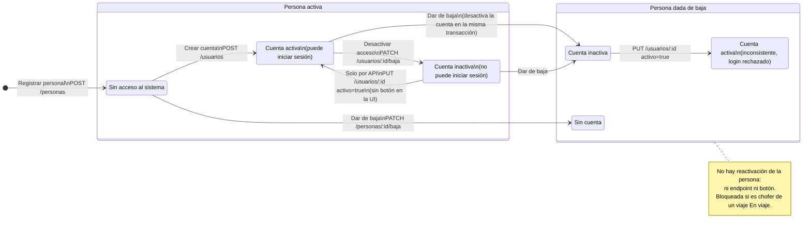

# Auditoría de Personal y Usuarios: Adri-Mar Gestión Online

Fecha: 24 oct 2026. Rama auditada: `chore/contract-personas-usuarios` (commit `0afce56`, con el contract de personas y usuarios ya aplicado).

Es un diagnóstico, sin cambios en la app. Leí el back y el front de los dos módulos y probé cada flujo de dos maneras: contra la API, con un script que deja cada request y su respuesta en un log, y en el navegador, con capturas a 1280 px y a 390 px. Usé una base PostgreSQL local con datos de prueba:

- 16 personas de los cuatro perfiles, con y sin cuenta, activas y dadas de baja.
- Un chofer con la cuenta bloqueada y la persona activa, y un chofer con perfil Chofer pero no habilitado.
- Una Encargada que conduce.
- 14 viajes: uno En viaje, varios Programados, un A confirmar con tres choferes candidatos y dos Finalizados.
- Documentación de choferes vigente, por vencer y vencida.

Uso las mismas gravedades y el mismo esfuerzo que [informe.md](informe.md):

- **Bloqueante:** permite algo que no debería pasar nunca (seguridad), o hace que alguien tome una decisión equivocada.
- **Alta:** genera errores o mucha fricción en una tarea frecuente.
- **Media:** genera inconsistencia o fricción que se nota, pero tiene solución alternativa.
- **Baja:** es pulido.

El esfuerzo es **chico** (menos de medio día), **mediano** (uno a tres días) o **grande** (más, o necesita una definición antes).

**Dónde está la evidencia.** Las capturas y los logs no están en el repo, sino en el scratchpad de la sesión: `C:\Users\levia\AppData\Local\Temp\claude\c--dev-Sistema-Adri-Mar-Adri-Mar\b06bd75f-de21-41eb-a37e-9473b6f5e3de\scratchpad\`.

- `capturas/`: 63 PNG con nombre `pantalla-estado-tamaño.png`, más `medidas.json` (scroll horizontal, controles de menos de 44 px y axe-core WCAG 2 A/AA por captura).
- `pruebas-api.log`: cada prueba contra la API, con el request y la respuesta. En el informe se citan como **G1** a **G10**.
- Los scripts que generan todo: `seed-auditoria.js`, `pruebas-api*.mjs` y `capturas.mjs`.

---

## Resumen

1. **Dar de baja, bloquear o cambiar el perfil no corta la sesión.** El token se renueva en cada request con el perfil viejo. Un chofer con la cuenta bloqueada comenzó y finalizó un viaje, y una Administradora dada de baja siguió creando personas (H1).
2. **Se puede dejar el sistema sin ningún Administrador activo.** Cualquiera puede darse de baja, bloquearse o bajarse el perfil a sí mismo, también el último Administrador (H2, H3).
3. **Un Encargado puede tomar la cuenta de otro Encargado.** Le cambia la contraseña y entra con ella. También puede bajarle el perfil o darlo de baja, y puede leer los datos de la cuenta de un Administrador (H4, H5).
4. **Dar de baja o deshabilitar a un chofer deja sus viajes Programados asignados, sin aviso.** Nadie se entera hasta que el viaje no se puede comenzar ("El chofer elegido está inactivo") (H6, H7).
5. **Hay estados sin salida y estados contradictorios.**
   - No se puede reactivar a una persona ni desbloquear una cuenta desde la UI. Volver a registrar a la persona falla por el DNI.
   - Bloquear la cuenta de un chofer activo deja su documentación en "solo consulta".
   - La API deja activar la cuenta de una persona dada de baja.

   (H8, H9, H10)

---

## Mapa del flujo

### Modelo

| Concepto | Dónde vive | Qué significa | Lo usa |
| --- | --- | --- | --- |
| **Persona** | `personas` ([schema.prisma:32-52](../../backend/prisma/schema.prisma#L32-L52)) | Quién es alguien en la empresa, tenga o no cuenta. Es dueña de los datos personales, del perfil, de la habilitación para conducir y del legajo de documentación. | Viajes (`chofer_persona_id`), candidatos, Documentación |
| **Usuario** | `usuarios` ([schema.prisma:57-72](../../backend/prisma/schema.prisma#L57-L72)) | La cuenta de acceso: `nombreUsuario`, `contrasenaHash` y `estadoUsuario`. Es 0..1 por persona (`personaId @unique`). | Login, auditoría (quién subió un documento, quién registró una lectura o un presupuesto) |
| **Perfil** | `perfiles`, en Persona | ADMINISTRADOR, ENCARGADO, PERSONAL_TALLER o CHOFER. Define los permisos de la cuenta. | `autorizar(...)` en todas las rutas, desde el **token** |
| **EstadoUsuario** | `estado_usuario`, en Usuario | ACTIVO o INACTIVO. INACTIVO impide iniciar sesión. En la UI se llama "Cuenta inactiva", "Desactivar acceso" o "dada de baja", según la pantalla. | `authService.login` ([authService.js:16](../../backend/src/services/authService.js#L16)) |
| **habilitadoParaConducir** | Persona | Si puede ser chofer de un viaje. Es independiente del perfil: un Encargado puede conducir y un Chofer puede no estar habilitado. En el alta, con perfil Chofer, arranca en `true`. | Selectores de chofer, `validarChofer`, "Mis viajes" en el menú (desde el token) |
| **activo / fechaBaja** | Persona | Baja lógica: la persona no se borra y conserva viajes y documentos. Al darla de baja también se desactiva su cuenta, en la misma transacción. | Login ([authService.js:20](../../backend/src/services/authService.js#L20)), `validarChofer`, listados de Documentación |

**Cómo se combinan hoy los dos estados** (persona × cuenta):

| Persona | Cuenta | ¿Inicia sesión? | ¿Se puede asignar como chofer? | Documentación (front) | Cómo se llega |
| --- | --- | --- | --- | --- | --- |
| Activa | Sin cuenta | No | Sí, si está habilitada | Editable | Alta en Personal |
| Activa | Activa | Sí | Sí, si está habilitada | Editable | "Crear acceso" |
| Activa | Inactiva | No | **Sí** (`validarChofer` mira solo la persona) | **Solo consulta** (error, ver H8) | "Desactivar acceso" |
| Dada de baja | Inactiva | No | No | Fuera del listado, ficha solo consulta | "Dar de baja" |
| Dada de baja | Sin cuenta | No | No | Ídem | "Dar de baja" |
| Dada de baja | **Activa** | No (la rechaza la persona) | No | Ídem | Solo por API: `PUT /usuarios/:id {activo:true}` (H10) |

### Flujos paso a paso

**1. Alta de persona**
1. Toolbar de Personal → "Registrar personal" → `abrirNuevo` ([Personal.jsx:139](../../frontend/src/pages/Personal.jsx#L139)).
2. Formulario ([Personal.jsx:226-298](../../frontend/src/pages/Personal.jsx#L226-L298)). Solo en el alta, elegir Chofer enciende y bloquea "Habilitado para conducir", y salir de Chofer lo apaga ([Personal.jsx:171-184](../../frontend/src/pages/Personal.jsx#L171-L184), [:215](../../frontend/src/pages/Personal.jsx#L215)). Un Encargado no ve la opción Administrador ([Personal.jsx:61-64](../../frontend/src/pages/Personal.jsx#L61-L64)).
3. `POST /personas` → [personaRoutes.js:7](../../backend/src/routes/personaRoutes.js#L7) → [personaController.js:3](../../backend/src/controllers/personaController.js#L3) → `crearPersona` ([personaService.js:157](../../backend/src/services/personaService.js#L157)):
   - valida nombre, apellido, perfil, DNI de 7 u 8 dígitos y formato de email ([:81-120](../../backend/src/services/personaService.js#L81-L120));
   - un Encargado no puede crear un Administrador ([:163](../../backend/src/services/personaService.js#L163));
   - `habilitadoParaConducir` toma el valor que llega, y si no llega nada, `perfil === 'CHOFER'` ([:74-79](../../backend/src/services/personaService.js#L74-L79));
   - un DNI o un email repetido dan un error por campo.
4. Vuelve al **listado** con el toast "Personal registrado correctamente.". No abre la ficha ni ofrece crear la cuenta.

**2. Crear el acceso desde la ficha de Personal**
1. "+ Crear acceso al sistema", solo si la persona está activa ([Personal.jsx:425-439](../../frontend/src/pages/Personal.jsx#L425-L439)). Navega a `/usuarios?crearConPersonaId=10&nombre=Jorge%20López`.
2. En Usuarios, un efecto pide `GET /personas?sinUsuario=true` y abre el formulario con la persona elegida ([Usuarios.jsx:99-113](../../frontend/src/pages/Usuarios.jsx#L99-L113)). Si la persona no está en esa lista, arma una opción con el nombre que vino en la URL ([Usuarios.jsx:263-267](../../frontend/src/pages/Usuarios.jsx#L263-L267)).
3. `POST /usuarios {personaId, nombreUsuario, contrasena}` → `crearUsuario` ([usuarioService.js:101](../../backend/src/services/usuarioService.js#L101)). Valida que la persona exista, que esté activa y que no tenga cuenta; que un Encargado no cree la cuenta de un Administrador ([:143](../../backend/src/services/usuarioService.js#L143)); que el nombre de usuario sea único ([:147](../../backend/src/services/usuarioService.js#L147)); y que la contraseña tenga 8 o más caracteres. La guarda con bcrypt.
4. Termina en el **listado de Usuarios**, no en la ficha de la persona. La URL conserva `?crearConPersonaId=…`: si se recarga, vuelve a abrir el formulario (captura `usuarios-recargar-despues-de-crear-escritorio.png`).

**3. Crear el acceso desde Usuarios.** "Crear cuenta" → `abrirNuevo` ([Usuarios.jsx:153](../../frontend/src/pages/Usuarios.jsx#L153)) pide las personas activas sin cuenta y muestra un `select` con "Nombre Apellido (DNI: … - Perfil)". Después sigue igual que el flujo 2.

**4. Editar persona.** Ficha → "Editar datos" → `abrirEditar` ([Personal.jsx:147](../../frontend/src/pages/Personal.jsx#L147)) → `PUT /personas/:id` con el formulario completo → `actualizarPersona` ([personaService.js:187](../../backend/src/services/personaService.js#L187)):
- Un Encargado no puede editar a un Administrador ni dar ese perfil ([:194-198](../../backend/src/services/personaService.js#L194-L198)).
- No se puede apagar "Habilitado para conducir" si la persona tiene un viaje En viaje ([:202](../../backend/src/services/personaService.js#L202)).
- Vuelve a validar todo. Es un reemplazo completo: un campo que no viene en el request se borra (H15).

Vuelve al listado.

**5. Cambiar el perfil.** Es el mismo flujo 4, con el select "Puesto / Perfil". Al editar, el switch de conducir no acompaña el cambio de perfil, como sí hace en el alta (PFm1). El perfil nuevo no llega a la sesión de esa persona hasta que vuelva a iniciar sesión, y la renovación del token conserva el viejo (H1).

**6. Habilitar o deshabilitar para conducir.** Es el switch del flujo 4. El back solo bloquea apagarlo si hay un viaje En viaje. Los viajes Programados y las candidaturas quedan como estaban (H7). Las personas que se pueden elegir como chofer salen de `listarDisponiblesParaConducir` ([personaService.js:318](../../backend/src/services/personaService.js#L318)): activas y habilitadas, tengan o no cuenta. El front todavía usa la ruta de antes, `/usuarios/disponibles-chofer`, que delega en esa misma función.

**7. Editar usuario.** Ficha de Usuarios → "Modificar credenciales" ([Usuarios.jsx:162](../../frontend/src/pages/Usuarios.jsx#L162)) → `PUT /usuarios/:id {nombreUsuario, contrasena?}` → `actualizarUsuario` ([usuarioService.js:181](../../backend/src/services/usuarioService.js#L181)). Un Encargado no puede tocar a un Administrador ([:188](../../backend/src/services/usuarioService.js#L188)). El campo `activo` existe ([:202](../../backend/src/services/usuarioService.js#L202)), pero el front nunca lo manda.

**8. Dar de baja a una persona.**
1. Ficha → "Dar de baja" → `ConfirmModal` ([Personal.jsx:472-493](../../frontend/src/pages/Personal.jsx#L472-L493)) → `PATCH /personas/:id/baja` → `darDeBajaPersona` ([personaService.js:233](../../backend/src/services/personaService.js#L233)).
2. El back verifica que un Encargado no dé de baja a un Administrador, que la persona no esté ya inactiva y que no tenga un viaje En viaje ([:242](../../backend/src/services/personaService.js#L242)).
3. En una transacción pasa la cuenta a INACTIVO y la persona a `activo=false`, con `fechaBaja` ([:253-262](../../backend/src/services/personaService.js#L253-L262)).
4. Vuelve al listado. Un 409 se muestra en un `Alert` arriba de todo (captura `personal-baja-error-en-viaje-*.png`).

**9. Reactivar a una persona.** **No existe.** No hay endpoint (G4: `/alta` y `/reactivar` dan 404, y `PUT` ignora `activo`) ni botón. Tampoco se la puede volver a registrar, porque su DNI ya existe (G10).

**10. Bloquear una cuenta.** Ficha de Usuarios → "Desactivar acceso" → modal → `PATCH /usuarios/:id/baja` → `darDeBajaUsuario` ([usuarioService.js:225](../../backend/src/services/usuarioService.js#L225)). La persona sigue activa y se la puede seguir asignando como chofer.

**11. Desbloquear una cuenta.** **No hay botón**: la ficha de una cuenta inactiva no tiene acciones ([Usuarios.jsx:419](../../frontend/src/pages/Usuarios.jsx#L419)). Solo se puede por API, con `PUT /usuarios/:id {activo:true}`, y la API lo acepta aunque la persona esté dada de baja (H10).

**12. Cambio y reseteo de contraseña.** Lo único que hay es que un gestor le escriba una contraseña nueva a otra cuenta, en "Modificar credenciales". **No hay "cambiar mi contraseña"**: nadie la pide ni conoce la actual. Tampoco hay reseteo ni cambio obligatorio en el próximo inicio de sesión. Un Chofer o alguien de Taller no tiene ninguna forma de cambiar la suya (H11).

**13. Inicio de sesión y sesión.**
- `authService.login` ([authService.js:7-55](../../backend/src/services/authService.js#L7-L55)) exige la cuenta ACTIVO y la persona activa. Emite un JWT con `{id, personaId, nombreUsuario, perfil, habilitadoParaConducir}`.
- En cada request, `autenticar` ([auth.js:3-34](../../backend/src/middlewares/auth.js#L3-L34)) solo verifica la firma. Después **re-emite un token nuevo con el mismo payload** ([auth.js:31](../../backend/src/middlewares/auth.js#L31)), sin consultar la base.
- El front reemplaza el token ([api.js:16-23](../../frontend/src/services/api.js#L16-L23)). Toma el perfil y el menú del `usuario` guardado en `localStorage` al iniciar sesión ([AuthContext.jsx:8](../../frontend/src/context/AuthContext.jsx#L8)), que no se vuelve a leer del servidor.

### Ciclo de vida de una persona y de su cuenta (hoy)



Lo que el diagrama no puede mostrar: **ninguna transición corta las sesiones abiertas** (H1). El perfil y la habilitación se cambian en cualquier estado activo, sin efecto sobre los tokens emitidos.

---

## Permisos

Personal de Taller y Chofer no acceden a nada de esto. El back responde 403 en `/personas`, `/usuarios` y `/usuarios/disponibles-chofer` (G8). El front los redirige a `/` desde `/personal` y `/usuarios`, y el menú no muestra los ítems (capturas `sin-acceso-taller-redirige-*.png` y `sin-acceso-chofer-redirige-*.png`). Esto está bien.

La tabla muestra qué puede hacer hoy cada perfil, verificado contra la API.

| Acción | Administrador | Encargado | Qué debería pasar |
| --- | --- | --- | --- |
| Ver el listado de Personal y de Usuarios | Todos | Todos menos los Administradores | OK |
| Ver la ficha de persona de un Administrador | Sí | No (403) | OK |
| Ver la **cuenta** de un Administrador (`GET /usuarios/:id`) | Sí | **Sí (200: DNI, email, teléfono)** | 403, igual que la persona (H5) |
| Crear una persona con perfil Administrador | Sí | No (403) | OK |
| Asignarle el perfil Administrador a alguien, también a sí mismo | Sí | No (403) | OK |
| Crear una persona Encargado y su cuenta | Sí | **Sí** | A definir (pregunta 1) |
| Editar o dar de baja a un Administrador | Sí, **también a sí mismo** | No (403) | No a sí mismo, y nunca al último Administrador (H2, H3) |
| Bajarse el propio perfil | **Sí, aunque quede sin Administradores** | **Sí** (de Encargado a Taller o Chofer) | No permitir cambiar el propio perfil (H3) |
| Editar, bajar el perfil o dar de baja a **otro Encargado** | Sí | **Sí** | A definir. Propuesta: solo el Administrador (H4) |
| Cambiar la contraseña o el usuario de **otro Encargado** | Sí | **Sí, y después entra con ella** | Solo el Administrador (H4) |
| Cambiar la contraseña de otro Administrador | Sí | No | A definir (pregunta 4) |
| Bloquear la **propia** cuenta | **Sí** | **Sí** (el botón está en su propia ficha) | No (H3) |
| Bloquear la cuenta de un Administrador | Sí | No | Nunca la del último Administrador (H2) |
| Desbloquear una cuenta | Solo por API | Solo por API (no las de Administrador) | Botón "Reactivar acceso", solo si la persona está activa (H9, H10) |
| Reactivar a una persona dada de baja | Nadie | Nadie | Botón "Reactivar" (pregunta 3) |
| Habilitar o deshabilitar para conducir | Sí, salvo con un viaje En viaje | Sí (no a Administradores) | Avisar o resolver los Programados (H7) |
| Cambiar la **propia** contraseña | Nadie | Nadie | Todos los perfiles (H11) |

---

## Huecos de lógica

**H1. Dar de baja, bloquear, cambiar el perfil o deshabilitar no corta la sesión. El token se renueva para siempre con los datos viejos.** Gravedad bloqueante, esfuerzo chico a mediano.
- **Evidencia (código):** `autenticar` verifica la firma y re-emite el token con el mismo payload en cada request ([auth.js:11-31](../../backend/src/middlewares/auth.js#L11-L31)). `autorizar` usa `req.usuario.perfil` del token ([auth.js:36-44](../../backend/src/middlewares/auth.js#L36-L44)). `ACTIVO` y `persona.activo` solo se miran en el login ([authService.js:16-22](../../backend/src/services/authService.js#L16-L22)).
- **Evidencia (API):**
  - G2: Adriana se dio de baja, y con su token previo siguió leyendo Personal y **creó una persona** (201). El back le renovó el token hasta una hora después. Carlos, ya pasado a Chofer en la base, **creó una persona con perfil Administrador** con su token previo.
  - G3b: con la cuenta de Ramiro bloqueada, su token previo **comenzó y finalizó el viaje 7** (200 y 200; en la base queda FINALIZADO).
  - G1: Diego se pasó a sí mismo a Personal de Taller y se bloqueó la cuenta. Con el mismo token siguió listando Usuarios, y el token renovado decía `"perfil":"ENCARGADO"`.
  - G6: Federico, deshabilitado, siguió viendo Mis viajes con su token previo.
- **Por qué importa:**
  - Dar de baja a alguien que se va de la empresa no le quita el acceso mientras siga usando la app. Con la renovación deslizante, nunca vence.
  - El TTL de los choferes es de 12 horas por defecto (`dominio.md` 6.2).
  - Bajarle el perfil a un Encargado tampoco tiene efecto.
  - El front empeora el problema: el menú y las rutas salen del `usuario` guardado en el login ([AuthContext.jsx:8](../../frontend/src/context/AuthContext.jsx#L8)).
- **Propuesta:**
  - En `autenticar`, leer de la base la cuenta y la persona por `payload.id` (una consulta con `select` de estado, `persona.activo`, perfil y habilitación) y responder 401 si la cuenta no está ACTIVO o la persona no está activa.
  - Tomar `perfil` y `habilitadoParaConducir` de la base, no del token, y re-emitir el token con esos valores.
  - Si se quiere evitar la consulta, una columna `versionSesion` en Usuario que se incremente al dar de baja, bloquear, cambiar el perfil o la habilitación y cambiar la contraseña. El token la lleva y se compara.
  - En el front, refrescar `usuario` desde `/auth/me` al cargar la app y cuando el token renovado traiga otro perfil.

**H2. Se puede dejar el sistema sin ningún Administrador activo.** Gravedad bloqueante, esfuerzo chico.
- **Evidencia (API, G2):** Carlos (Administrador) se pasó a Chofer (200). Adriana (la última Administradora) se dio de baja (200). Consulta a la base: "Administradores activos: 0". Después, `login amartinez` → 401.
- **Por qué importa:** nadie más puede crear Administradores. Un Encargado no puede asignar ese perfil, así que la única salida es tocar la base a mano. Además, con H1, las sesiones previas siguen vivas.
- **Propuesta:** antes de cambiar el perfil de un Administrador, darlo de baja o bloquearle la cuenta, contar los Administradores activos con cuenta ACTIVO sin contar a esa persona. Si quedan 0, responder 409 "Tiene que quedar al menos un Administrador activo". Va en `actualizarPersona`, `darDeBajaPersona`, `darDeBajaUsuario` y `actualizarUsuario` (cuando `activo=false`).

**H3. Cualquiera puede darse de baja, bloquearse o cambiarse el perfil a sí mismo.** Gravedad alta, esfuerzo chico.
- **Evidencia (API):** G1 (Diego se bajó el perfil y se bloqueó la cuenta), G2 (Adriana se dio de baja) y G3 (Adriana se bloqueó). En el navegador, la ficha de la propia cuenta del Encargado ofrece "Modificar credenciales" y "Desactivar acceso" (captura `usuarios-ficha-propia-encargado-escritorio.png`).
- **Por qué importa:** es un error fácil de cometer y no tiene vuelta atrás desde la UI (H9). Combinado con H2, deja al sistema sin administración.
- **Propuesta:**
  - En el back, comparar `req.usuario.personaId` con la persona objetivo y responder 409: "No podés darte de baja a vos mismo", "No podés bloquear tu propia cuenta" o "No podés cambiar tu propio perfil".
  - En el front, ocultar "Dar de baja" y "Desactivar acceso" en la ficha propia, y dejar Perfil de solo lectura con el hint "Tu perfil lo cambia otro Administrador".

**H4. Un Encargado puede tomar la cuenta de otro Encargado y dejarlo afuera.** Gravedad alta, esfuerzo chico.
- **Evidencia (API, G1):** Diego le cambió la contraseña a Lucía (200), y `login lromero` con esa contraseña entró como ENCARGADO. Le cambió el nombre de usuario a `lucia.vieja` (200) y le bajó el perfil a Chofer (200). Las reglas solo protegen al perfil Administrador ([usuarioService.js:188](../../backend/src/services/usuarioService.js#L188), [personaService.js:194](../../backend/src/services/personaService.js#L194)).
- **Por qué importa:** un Encargado entra como otro y lo que haga queda registrado a nombre del otro en la auditoría (documentos, lecturas, presupuestos). Además, ninguna de estas acciones queda registrada: no hay "modificado por".
- **Propuesta:**
  - Depende de la pregunta 1. Como mínimo, que la contraseña y el nombre de usuario de un Encargado los cambie solo un Administrador.
  - Si el negocio no lo necesita, que un Encargado solo gestione a Taller y Choferes.

**H5. `GET /usuarios/:id` no controla el perfil de quien consulta.** Gravedad media, esfuerzo chico.
- **Evidencia:** el controller no pasa `perfilSolicitante` ([usuarioController.js:32-42](../../backend/src/controllers/usuarioController.js#L32-L42)). G1: un Encargado lee `GET /usuarios/1` (la Administradora) → 200 con DNI, email y teléfono. La misma persona por `GET /personas/1` → 403.
- **Por qué importa:** es la misma regla aplicada a medias. No expone el hash, pero sí datos personales.
- **Propuesta:** el mismo chequeo que `obtenerPersona` ([personaService.js:151](../../backend/src/services/personaService.js#L151)).

**H6. Dar de baja a un chofer deja sus viajes Programados asignados, y nadie se entera.** Gravedad alta, esfuerzo mediano (necesita la pregunta 2).
- **Evidencia (API, G5 y G5b):**
  - Un viaje **En viaje** está bien resuelto: la baja de Ana da 409 "Debe finalizarse antes de darla de baja".
  - Con **Programados**, la baja de Ramiro da 200. Sus viajes 6 (30 oct, Rosario) y 7 (2 nov) siguen Programados a su nombre y aparecen en Próximos.
    - Comenzar el viaje 6 → 400 "El chofer elegido está inactivo".
    - Editar el viaje 6 sin cambiar el chofer → 400 con el mismo error. Hay que cambiar el chofer para poder guardar cualquier otra cosa.
  - Con un **A confirmar**, Ramiro sigue entre los candidatos del viaje 11 (`viaje_chofer_candidato` = 14, 15, 16). La disponibilidad lo marca "Usuario dado de baja", y confirmarlo da 400.
  - **Documentación:** la carpeta se conserva (`GET /documentos/choferes/14` → 2 documentos). Ramiro sale del listado de Choferes y de las alertas. Esto está bien.
  - El modal de baja no menciona ningún viaje (captura `personal-modal-baja-escritorio.png`).
- **Por qué importa:** el viaje del 30 oct queda sin un chofer real y se descubre el día del viaje, cuando el chofer no puede comenzarlo o cuando alguien intenta editarlo. El motivo "Usuario dado de baja" ([viajeService.js:1180](../../backend/src/services/viajeService.js#L1180)) habla de un usuario, pero lo dado de baja es la persona.
- **Propuesta:**
  - Un endpoint de impacto (`GET /personas/:id/impacto-baja`) que devuelva los Programados futuros y las candidaturas.
  - Que el modal los liste: "Tiene 2 viajes programados: jue 30 oct Río Tercero → Rosario y lun 02 nov Río Tercero → Villa Carlos Paz".
  - Según la pregunta 2, hay dos caminos:
    - (a) Bloquear la baja con 409 hasta reasignarlos, igual que con En viaje. Es lo más simple y coherente.
    - (b) Dar de baja igual: los viajes pasan a A confirmar sin chofer y se borran las candidaturas, en la misma transacción.
  - En los dos casos, cambiar el motivo a "Dado de baja".

**H7. Deshabilitar para conducir tiene el mismo problema, y además el chofer deja de ver su viaje.** Gravedad alta, esfuerzo chico (si se reusa H6).
- **Evidencia (API, G6):**
  - Ana (En viaje) → 409. Esto está bien.
  - Federico → 200. El viaje 8 (31 oct) sigue Programado a su nombre y sigue siendo candidato del viaje 11.
  - Con su token previo, Federico ve el viaje en Mis viajes, y comenzarlo da 400 "El chofer elegido no está habilitado para conducir".
  - Cuando vuelve a iniciar sesión, su token dice `habilitadoParaConducir=false` y el menú oculta "Mis viajes" ([navegacion.js:18](../../frontend/src/constants/navegacion.js#L18)). Su viaje asignado deja de estar a la vista.
- **Propuesta:** el mismo aviso o bloqueo que en H6 al apagar el switch. En el formulario, un texto de ayuda debajo del switch: "Tiene 1 viaje programado (vie 31 oct). Reasignalo antes de deshabilitarlo".

**H8. Bloquear la cuenta de un chofer activo deja su documentación en "solo consulta".** Gravedad alta, esfuerzo chico.
- **Evidencia:**
  - El front decide "solo consulta" por `estadoUsuario` ([Documentacion.jsx:456-458](../../frontend/src/pages/Documentacion.jsx#L456-L458)).
  - El back arma `estadoUsuario` con el de la cuenta, si existe ([documentoService.js:146](../../backend/src/services/documentoService.js#L146), [:583](../../backend/src/services/documentoService.js#L583)).
  - Pero para registrar documentos, el back mira la persona ([documentoService.js:123-130](../../backend/src/services/documentoService.js#L123-L130)).
  - G9: Pablo Medina tiene `activo=true` y `estadoUsuario=INACTIVO`. La captura `documentacion-ficha-chofer-cuenta-bloqueada-escritorio.png` muestra "Usuario inactivo: la documentación es de solo consulta", sin "Actualizar".
  - Mientras tanto, Pablo sigue asignado al viaje del 29 oct y se lo puede elegir como chofer.
- **Por qué importa:** bloquear la cuenta es una decisión sobre el acceso, no sobre el legajo. No se le puede renovar la licencia a alguien que sigue manejando.
- **Propuesta:** `soloConsulta = !titular.activo`. Que el back exponga `activo` de la persona como fuente de verdad y deje de derivar `estadoUsuario` para los choferes.

**H9. No hay salida para una baja o un bloqueo hechos por error.** Gravedad alta, esfuerzo mediano.
- **Evidencia:**
  - No hay endpoint de reactivación (G4: 404) y `PUT /personas` ignora `activo`.
  - Volver a registrar a la persona falla: G10, `POST /personas` con el DNI de Néstor → 400 "Ese DNI ya está registrado".
  - La ficha de una cuenta inactiva no tiene acciones ([Usuarios.jsx:419](../../frontend/src/pages/Usuarios.jsx#L419), captura `usuarios-ficha-inactiva-escritorio.png`).
  - El modal de baja no avisa que no se puede deshacer, cuando el de Flota sí lo hace.
- **Por qué importa:** en transporte es común el reingreso de choferes (por temporada, por suplencias). Hoy esa persona queda bloqueada para siempre, con su historial y su DNI.
- **Propuesta:**
  - `PATCH /personas/:id/reactivar`: pone `activo=true` y `fechaBaja=null` y **no** reactiva la cuenta.
  - "Reactivar acceso" en la cuenta, solo si la persona está activa.
  - Los dos con su botón en la ficha. Quién puede, según la pregunta 3.

**H10. La API permite una cuenta activa en una persona dada de baja.** Gravedad media, esfuerzo chico.
- **Evidencia (API, G4):** `PUT /usuarios/10 {activo:true}` con Néstor dado de baja → 200. En la base: `persona.activo=f` y cuenta ACTIVO. El login lo sigue rechazando ([authService.js:20](../../backend/src/services/authService.js#L20)), pero la ficha de Personal mostraría el badge "Baja" junto a "Cuenta activa". También se le puede cambiar la contraseña (200).
- **Propuesta:** en `actualizarUsuario`, rechazar `activo=true` y los cambios de credenciales si la persona está dada de baja: "Reactivá primero a la persona".

**H11. Nadie puede cambiar su propia contraseña.** Gravedad media, esfuerzo mediano.
- **Evidencia:** no hay ruta ni pantalla para hacerlo. La única forma es que un gestor escriba una contraseña nueva en "Modificar credenciales" ([Usuarios.jsx:184-197](../../frontend/src/pages/Usuarios.jsx#L184-L197)). No pide la contraseña actual, y tampoco hay cambio obligatorio después.
- **Por qué importa:** el gestor conoce la contraseña de cada chofer. Un chofer que la olvida depende de que alguien de oficina esté disponible. Y el email es opcional, así que un reseteo por mail no alcanza para todos.
- **Propuesta:**
  - "Cambiar mi contraseña" en el menú del usuario de la sidebar, con la contraseña actual y la nueva, para todos los perfiles.
  - Cuando un gestor define una contraseña, que sea provisoria: `debeCambiarContrasena=true`, y en el próximo inicio de sesión se pide cambiarla.

**H12. Validaciones que están solo en el front.** Gravedad media, esfuerzo chico.
- **Evidencia:**

  | Regla | Front | Back | Prueba |
  | --- | --- | --- | --- |
  | Perfil Chofer → habilitado para conducir, en el alta | Switch encendido y bloqueado ([Personal.jsx:215](../../frontend/src/pages/Personal.jsx#L215)) | Acepta `CHOFER` con `false` | G7: 201 |
  | No editar a una persona dada de baja | Oculta "Editar datos" ([Personal.jsx:458](../../frontend/src/pages/Personal.jsx#L458)) | `PUT` responde 200 | G4: 200 |
  | Contraseña con solo espacios | Al editar no la manda ([Usuarios.jsx:193](../../frontend/src/pages/Usuarios.jsx#L193)) | En el alta acepta 8 espacios | G7: 201, y el login con 8 espacios entra |
  | No ofrecer reactivar una cuenta | No hay botón | La acepta, también en una persona dada de baja | G4 (H10) |

- **El resto está bien:** el perfil Administrador para un Encargado, "Crear acceso" solo para personas activas y la cuenta duplicada están validados en los dos lados. Los formularios usan `noValidate` y muestran los errores del back todos juntos, en cada campo (captura `personal-alta-errores-escritorio.png`). Es mejor que la validación en dos tandas de Viajes y Flota.
- **Propuesta:** decidir las dos primeras reglas (preguntas 5 y 9) y aplicarlas en el back. Rechazar las contraseñas con solo espacios.

**H13. Faltan validaciones en los dos lados.** Gravedad baja, esfuerzo chico.
- **Evidencia (G7):**
  - El teléfono acepta "llamar a la tarde, no contesta". Eso rompe "Avisar por WhatsApp", que arma el enlace con ese dato.
  - El nombre acepta 300 caracteres.
  - El nombre de usuario acepta espacios ("hugo paz") y distingue mayúsculas: "AMartinez" se creó al lado de "amartinez".
  - 30 intentos de login fallidos seguidos dieron 30 respuestas 401, sin demora ni bloqueo.
  - El DNI solo admite 7 u 8 dígitos (pregunta 7).
- **Propuesta:**
  - Normalizar el nombre de usuario a minúsculas, sin espacios, con letras, números, punto o guion, y que el único sea sin distinguir mayúsculas.
  - Largo máximo para los textos.
  - Teléfono con dígitos, espacios, guiones y `+`.
  - Una demora o un bloqueo temporal por intentos fallidos en `/auth/login`.

**H14. El buscador de Usuarios promete buscar por DNI, pero no lo hace.** Gravedad media, esfuerzo chico.
- **Evidencia:** el placeholder dice "Buscar por usuario, nombre o DNI" ([Usuarios.jsx:323](../../frontend/src/pages/Usuarios.jsx#L323)), pero el back busca solo por usuario, nombre y apellido ([usuarioService.js:255-257](../../backend/src/services/usuarioService.js#L255-L257)). G7: `?busqueda=29333777` → 0 resultados. Captura `usuarios-buscar-dni-escritorio.png`: "No se encontraron cuentas de usuario" con Martín en la base.
- **Propuesta:** agregar `persona.dni`, con el mismo `replace(/\./g, '')` que ya usa Personal ([personaService.js:288](../../backend/src/services/personaService.js#L288)).

**H15. `PUT /personas/:id` borra lo que no se manda.** Gravedad baja, esfuerzo chico.
- **Evidencia (G1):** el Encargado le cambió solo el perfil a Lucía por API, y su email y su teléfono quedaron en `null`. Hoy el front manda el formulario completo, así que en la UI no pasa nada.
- **Propuesta:** documentarlo como reemplazo completo, o pasar a `PATCH` con los campos presentes, como hace `actualizarDatosAdministrativos` en Viajes.

**H16. La documentación del dominio contradice el código.** Gravedad baja, esfuerzo chico.
- `dominio.md` 5.2 dice que el chofer "debe tener perfil Chofer". El código acepta a cualquier persona habilitada, por SCRUM-27 (un Encargado que conduce).
- `dominio.md` 6.1 no le da al Encargado gestión de usuarios, pero el código sí.
- En el design system, `FormularioUsuario.md` y la "Ficha de usuario" de `FichaDetalle.md` describen el modelo anterior a la separación: un solo formulario con nombre, DNI, usuario y contraseña.
- **Propuesta:** actualizarlos después de responder las preguntas.

**H17. Hay dos significados de "chofer".** Gravedad media, esfuerzo chico (necesita la pregunta 5).
- **Evidencia:**
  - Sergio Ríos tiene perfil Chofer y no está habilitado. En Personal no lleva la marca "Chofer", pero aparece en Documentación › Choferes (G9: el listado filtra por "perfil Chofer **o** habilitado", [documentoService.js:569](../../backend/src/services/documentoService.js#L569)). No se lo puede asignar a ningún viaje.
  - Lucía (Encargada habilitada) lleva la marca "Chofer" en Personal.
- **Por qué importa:** "Chofer" quiere decir "perfil" en un lugar y "puede manejar" en otro. Es la raíz del "Chofer" repetido (PL1, PF2).
- **Propuesta:** decidir si el perfil Chofer sin habilitar tiene sentido. Si no lo tiene, en el back el perfil Chofer implica estar habilitado, y en la UI "Chofer" es solo el perfil y la habilitación se muestra como "habilitado para conducir" en los demás perfiles.

---

## UI por pantalla

La referencia de ficha es Flota (`referencia-flota-ficha-escritorio.png`): una sola `Card` con la grilla de pares, un solo `EstadoBadge` a la derecha del `h1`, sin títulos de sección y con las acciones dentro de la card, alineadas con la grilla. La ficha de chofer en Documentación (`referencia-documentacion-ficha-chofer-escritorio.png`) agrega el subtítulo "Chofer", o "Encargado · habilitado para conducir" ([Documentacion.jsx:73-77](../../frontend/src/pages/Documentacion.jsx#L73-L77)).

**Medidas automáticas (63 capturas):**
- Ninguna tiene scroll horizontal a 390 px.
- Axe encontró una sola violación: **contraste** del subtítulo de la ficha de Personal (`.personal-subtitulo`), en las 17 capturas de esa ficha (ver PF1).
- Los controles de menos de 44 px son "Cerrar sesión" (26 × 26, ya reportado en N1 de `informe.md`) y el label del switch "Habilitado para conducir" (24 px de alto).

### Personal: listado

**PL1. "Chofer" aparece dos veces y quiere decir dos cosas.** Gravedad media, esfuerzo chico.
- **Captura:** `personal-listado-admin-escritorio.png` y `personal-listado-admin-celular.png`.
- **Qué pasa:**
  - En los choferes, "Chofer" sale arriba a la derecha (está habilitado) y otra vez como sub (el perfil) ([Personal.jsx:329-340](../../frontend/src/pages/Personal.jsx#L329-L340)).
  - En Lucía, "Chofer" aparece al lado de "Encargado".
  - En Sergio (perfil Chofer, no habilitado) no aparece nada, y es justo el caso que vale la pena señalar.
- **Propuesta:**
  - Sacar la marca de arriba.
  - En el sub, usar el mismo texto que Documentación: "Chofer" o "Encargado · habilitado para conducir".
  - Si el perfil es Chofer y no está habilitado, poner en el pie, en gris: "No habilitado para conducir".

**PL2. El estado de la cuenta no se ve.** Gravedad media, esfuerzo chico.
- **Qué pasa:** Pablo (cuenta bloqueada) muestra "Activo" y "@pmedina", igual que alguien con acceso. Néstor (dado de baja) también muestra "@nvega".
- **Propuesta:** en el pie, "@pmedina · acceso bloqueado". Si la persona está dada de baja, no mostrar el usuario.

**PL3. Las personas dadas de baja están mezcladas con las activas y no hay filtro.** Gravedad media, esfuerzo chico.
- **Qué pasa:** Claudia y Néstor quedan entre los activos, ordenados por perfil. Con el tiempo, la lista va a tener más bajas que activos. El badge dice "Baja", y en Flota dice "Dado de baja".
- **Propuesta:**
  - Un `ControlSegmentado` "Activas | Dadas de baja", con la cantidad de cada una, en la misma posición que en Documentación. Por defecto, "Activas".
  - Badge "Dada de baja" o "Dado de baja", según el caso, como en Flota.

**PL4. Si falla la red, dice "No se encontró personal".** Gravedad media, esfuerzo chico.
- **Captura:** `personal-error-red-escritorio.png` y `usuarios-error-red-escritorio.png`.
- **Qué pasa:** es el mismo T1 de `informe.md`: `.then().finally()` sin `.catch()` ([Personal.jsx:85-94](../../frontend/src/pages/Personal.jsx#L85-L94), [Usuarios.jsx:74-83](../../frontend/src/pages/Usuarios.jsx#L74-L83)).
- **Propuesta:** un `Alert` de error con "Reintentar", como en Documentación.

**PL5. El buscador recarga la lista en cada tecla.** Gravedad baja, esfuerzo chico.
- **Qué pasa:** cada letra hace un request y vuelve a mostrar el esqueleto, sin espera entre teclas. Las respuestas pueden llegar desordenadas.
- **Propuesta:** esperar 300 ms antes de buscar, o filtrar en el cliente, como Documentación. Son decenas de personas.

**PL6. Los títulos no siguen `Listado.md`.** Gravedad baja, esfuerzo chico.
- **Qué pasa:** los `h1` (ocultos para el lector de pantalla) dicen "Personal de la Empresa" y "Cuentas de Usuario (Acceso al Sistema)", en Title Case. El design system pide el mismo texto que el ítem del menú: "Personal" y "Usuarios".

### Personal: ficha

**PF1. La caja "Cuenta de acceso al sistema" sale en azul oscuro, por tokens que no existen.** Gravedad alta, esfuerzo chico.
- **Captura:** `personal-ficha-chofer-con-cuenta-escritorio.png`.
- **Qué pasa:**
  - [Personal.css](../../frontend/src/pages/Personal.css) usa seis variables que no están definidas en [index.css](../../frontend/src/index.css): `--color-surface-card`, `--color-text-muted`, `--color-primary`, `--color-primary-light`, `--color-surface-hover` y `--color-danger` (esta última, inline en [Personal.jsx:483](../../frontend/src/pages/Personal.jsx#L483)).
  - Por eso se aplican los valores de respaldo, que son de un tema oscuro: fondo `#1e293b` ([Personal.css:102](../../frontend/src/pages/Personal.css#L102)), texto azul `#60a5fa` en monoespaciada y textos grises `#94a3b8`.
  - Ese gris da un contraste de 2,6:1 sobre blanco. Es la falla de axe en el subtítulo, y afecta también al texto de "Documentación y licencias".
- **Por qué importa:** es la única caja oscura de la app, y llama la atención sobre un dato secundario. El design system tiene un solo tema y un solo azul.
- **Propuesta:** usar solo tokens de `index.css` (`color-text-secondary`, `color-border`, `brand-*`). Se resuelve de fondo con la ficha nueva (ver "Propuesta").

**PF2. "Chofer" se repite cuatro veces, y el emoji y los dos badges compiten.** Gravedad media, esfuerzo chico (problema ya conocido).
- **Captura:** `personal-ficha-chofer-con-cuenta-escritorio.png` y `-celular.png`.
- **Qué pasa:** aparece en el subtítulo "Chofer", en el badge "🚗 Habilitado para conducir" (estilo propio, [Personal.css:29-45](../../frontend/src/pages/Personal.css#L29-L45)), en "Puesto / Perfil: Chofer" y en "Habilitado para conducir: Sí". En el celular, los dos badges ocupan una fila entera. La persona dada de baja sigue mostrando el badge de habilitado (`personal-ficha-dado-de-baja-escritorio.png`).
- **Propuesta:**
  - Un solo `EstadoBadge` md: Activa o Dada de baja.
  - El subtítulo como en Documentación.
  - En la grilla, el par "Perfil | Habilitado para conducir".
  - Sin emoji.

**PF3. La estructura no es la de las demás fichas.** Gravedad media, esfuerzo chico.
- **Captura:** `personal-ficha-sin-cuenta-escritorio.png` comparada con `referencia-flota-ficha-escritorio.png`.
- **Qué pasa:**
  - Hay dos secciones con `h3` y borde ("Cuenta de acceso al sistema" y "Documentación y licencias"). `FichaDetalle.md` dice "sin títulos de sección".
  - Las secciones no tienen padding: el texto toca el borde de la card. En el celular se nota mucho.
  - Los botones quedan en tres sangrías distintas: "Ver legajo…" pegado al borde, "Editar datos" y "Dar de baja" con margen.
  - "+ Crear acceso al sistema" es primario, con "+", y compite con todo lo demás (problema ya conocido).
  - "Administrar cuenta" ocupa dos líneas en el celular.
- **Propuesta:** ver "Cómo debería verse la ficha".

**PF4. La ficha de una persona dada de baja no dice cuándo se dio de baja ni ofrece nada.** Gravedad media, esfuerzo chico.
- **Captura:** `personal-ficha-dado-de-baja-escritorio.png`.
- **Qué pasa:** falta "Dado de baja el", que Flota sí muestra. No hay "Reactivar" (H9). Solo queda "Ver legajo".
- **Propuesta:** el par "Registrado el | Dado de baja el", un `Alert` info "Dada de baja el 15 sep 2026. Sus datos son de solo consulta." y "Reactivar" para quien pueda.

**PF5. "Ver legajo en Documentación" no lleva al legajo.** Gravedad media, esfuerzo chico.
- **Qué pasa:** navega a `/documentacion` ([Personal.jsx:451](../../frontend/src/pages/Personal.jsx#L451)), que abre en la vista Vehículos (captura `personal-ver-legajo-destino-escritorio.png`). Documentación ya acepta `?tab=choferes&choferId=8`. Además, el texto de ayuda trata de usted: "Gestione licencias…".
- **Propuesta:** un botón "Ver documentación" (secondary) que lleve a `/documentacion?tab=choferes&choferId=${id}`, igual que en Flota.

**PF6. La ficha no tiene URL propia.** Gravedad media, esfuerzo chico.
- **Qué pasa:**
  - Abrir una ficha desde el listado no cambia la URL. "Atrás" del navegador sale de Personal: en la prueba, volvió a `/viajes`.
  - `?id=` solo se lee al entrar ([Personal.jsx:89-92](../../frontend/src/pages/Personal.jsx#L89-L92)) y queda en la URL. Si se entra por `?id=8`, se toca "Volver al listado" y se busca "Gó", **la ficha se vuelve a abrir sola** (captura `personal-buscar-reabre-ficha-escritorio.png`).
  - Un Encargado que entra a `/personal?id=1` (una Administradora) ve el listado sin ningún aviso.
- **Propuesta:** el patrón de Documentación ([Documentacion.jsx:108-116](../../frontend/src/pages/Documentacion.jsx#L108-L116)): la ficha abierta vive en la URL (`setSearchParams`), "Volver" la saca y "Atrás" funciona. Si la ficha no se encuentra, mostrar "No se encontró esa persona".

**PF7. Los textos no siguen el estilo del resto de la app.** Gravedad baja, esfuerzo chico.
- "Puesto / Perfil": solo existe el perfil.
- "Fecha de registro": en Flota dice "Registrado el".
- "Gestione…" trata de usted.
- "Personal dado de baja correctamente." y "Personal registrado correctamente." usan "personal" para una persona.
- **Propuesta:** "Perfil", "Registrado el", "Gestioná…" (o sacarlo), y "Martín Gómez quedó dado de baja." o "Persona registrada.".

### Personal: formularios

**PFm1. Al editar, el perfil y la habilitación no se acompañan.** Gravedad media, esfuerzo chico.
- **Captura:** `personal-editar-chofer-escritorio.png`.
- **Qué pasa:** la regla de "Chofer → habilitado" corre solo en el alta (`!editando`, [Personal.jsx:171](../../frontend/src/pages/Personal.jsx#L171)). Al editar, se puede pasar a alguien a Chofer y dejarlo sin habilitar, o al revés, sin ningún aviso. El back tampoco lo impide (H12).
- **Propuesta:** la misma regla en el alta y en la edición, la que salga de la pregunta 5. Al apagar el switch, el aviso de viajes programados (H7).

**PFm2. El formulario está bien resuelto, salvo detalles.** Gravedad baja, esfuerzo chico.
- **Captura:** `personal-alta-escritorio.png` y `personal-alta-errores-escritorio.png`.
- **Lo bueno:** usa pares como en el design system y muestra todos los errores juntos.
- **Detalles:**
  - "Email (opcional)" lleva la aclaración, pero Teléfono, que también es opcional, no.
  - El primario va primero (T3 de `informe.md`).
  - Después de guardar vuelve al listado y no a la ficha (T2). Un chofer recién creado no ofrece "Crear acceso" ni "Cargar licencia".
- **Propuesta:** sacar "(opcional)" (el asterisco ya marca los obligatorios). Después del alta, abrir la ficha nueva con el toast.

### Usuarios: listado y ficha

**UL1. El listado repite Personal y no deja ver la persona.** Gravedad media, esfuerzo chico.
- **Captura:** `usuarios-listado-admin-escritorio.png`.
- **Qué pasa:**
  - Son las mismas personas, con otro título: "@usuario".
  - Ordena por perfil y **nombre**; Personal ordena por perfil y **apellido**.
  - Néstor (dado de baja) aparece solo como cuenta "Inactiva", igual que Pablo, que está activo y tiene la cuenta bloqueada. No se distingue si se bloqueó la cuenta o si la persona se fue.
- **Propuesta:** si se mantiene la pantalla (ver "Propuesta"), mostrar el estado de la persona en el pie ("Dado de baja el 15 sep") y ordenar igual que en Personal.

**UF1. La ficha de una cuenta inactiva no tiene ninguna acción.** Gravedad alta, esfuerzo chico.
- **Captura:** `usuarios-ficha-inactiva-escritorio.png`.
- **Qué pasa:** solo muestra "Ver ficha de personal completa →" ([Usuarios.jsx:419](../../frontend/src/pages/Usuarios.jsx#L419)). Ver H9.
- **Propuesta:** "Reactivar acceso" (secondary), si la persona está activa. Si no, el texto "La persona está dada de baja. Reactivala desde su ficha".

**UF2. La ficha de la cuenta repite los datos de la persona y tiene estilos propios.** Gravedad media, esfuerzo chico.
- **Captura:** `usuarios-ficha-activa-escritorio.png` y `usuarios-ficha-propia-encargado-escritorio.png`.
- **Qué pasa:**
  - Repite nombre, DNI, perfil y habilitado para conducir, que son datos de la persona.
  - "Nombre de usuario (Login)" repite el `h1`.
  - Lo propio de la cuenta (usuario, estado, fecha de creación) queda mezclado con lo demás.
  - Tiene estilos inline ([Usuarios.jsx:370](../../frontend/src/pages/Usuarios.jsx#L370), [:407](../../frontend/src/pages/Usuarios.jsx#L407), [:244](../../frontend/src/pages/Usuarios.jsx#L244), [:443](../../frontend/src/pages/Usuarios.jsx#L443)).
  - "Ver ficha de personal completa →" queda fuera de la sangría de la grilla y desalineado de los otros dos botones.
  - En la ficha propia ofrece "Desactivar acceso" (H3).
- **Propuesta:** se resuelve con la decisión de la sección "Propuesta".

### Usuarios: formularios

**UFm1. Crear una cuenta desde Personal termina en otra pantalla, y la URL queda sucia.** Gravedad media, esfuerzo chico.
- **Captura:** `usuarios-alta-desde-personal-escritorio.png`, `usuarios-creada-desde-personal-escritorio.png` y `usuarios-recargar-despues-de-crear-escritorio.png`.
- **Qué pasa:**
  - "← Volver al listado", "Cancelar" y "Crear cuenta" llevan al listado de **Usuarios**, no a la ficha de la persona desde la que se salió.
  - El nombre de la persona viaja en la URL (`&nombre=`).
  - Si se recarga después de crear, el formulario se vuelve a abrir con la persona que ya tiene cuenta. Al enviarlo, da el error "Esta persona ya tiene una cuenta de usuario asignada".
- **Propuesta:** crear la cuenta en la ficha de la persona (en un modal o en la misma página) y volver a la ficha con el toast. Si se mantiene la ruta, limpiar los parámetros al abrir el formulario.

**UFm2. El formulario de alta tiene textos de sistema.** Gravedad baja, esfuerzo chico.
- **Captura:** `usuarios-alta-escritorio.png`.
- **Qué pasa:**
  - El label dice "Seleccionar persona en la empresa" y el hint, "Asigna esta cuenta a un miembro del personal", que no es voseo.
  - Las opciones dicen "Jorge López (DNI: 29.333.777 - Chofer)".
  - Es un `select` sin búsqueda.
  - No hay forma de ver la contraseña que se escribe, y el gestor tiene que comunicarla a mano (H11).
- **Propuesta:**
  - Label "Persona" y opciones "Jorge López · Chofer · DNI 29.333.777".
  - Sugerir el nombre de usuario a partir del nombre ("jlopez").
  - Un botón para mostrar la contraseña.
  - Si se adopta H11, "Contraseña provisoria", con el hint "La va a cambiar en su primer inicio de sesión".

**UFm3. "Modificar credenciales de acceso" usa un input deshabilitado como dato.** Gravedad baja, esfuerzo chico.
- **Captura:** `usuarios-editar-escritorio.png`.
- **Qué pasa:** "Persona vinculada" es un `input` deshabilitado con opacidad inline que dice "Martín Gómez (Perfil: Chofer)". El `h1` no dice de quién es la cuenta.
- **Propuesta:** `h1` "Cambiar contraseña de @mgomez", con la persona como subtítulo. Separar "Cambiar usuario" de "Cambiar contraseña": son acciones distintas.

### Modales

**PM1. El modal "Dar de baja personal" no avisa lo importante.** Gravedad media, esfuerzo chico.
- **Captura:** `personal-modal-baja-escritorio.png` y `personal-modal-baja-celular.png`.
- **Qué pasa:**
  - No lista los viajes programados ni las candidaturas (H6).
  - No dice que no se puede deshacer.
  - El aviso de la cuenta usa "⚠️" y rojo inline `#ef4444` ([Personal.jsx:483-485](../../frontend/src/pages/Personal.jsx#L483-L485)). Ese rojo da 3,8:1 sobre blanco: por debajo de AA en 14 px, y fuera de los tokens `state-error-*`.
  - El título no es una pregunta (el README de `ConfirmModal` pide "¿…?").
  - Si el back responde 409 (chofer En viaje), el modal se cierra y el error aparece arriba de todo (`personal-baja-error-en-viaje-escritorio.png`). El front podría saberlo antes.
- **Propuesta:**
  - Título "¿Dar de baja a Martín Gómez?".
  - Cuerpo:
    - "Va a dejar de aparecer como chofer disponible y su cuenta @mgomez se desactiva."
    - La lista de viajes afectados.
    - "Vas a poder reactivarla más adelante", si se hace H9.
  - Si tiene un viaje En viaje, no abrir el modal: deshabilitar el botón con el motivo visible debajo, con el patrón de `AvisarPorWhatsApp`.
  - Sin emojis ni colores inline.

**UM1. Cuatro palabras para el estado de una cuenta.** Gravedad media, esfuerzo chico.
- **Captura:** `usuarios-modal-desactivar-escritorio.png`.
- **Qué pasa:**
  - La acción se llama "Desactivar acceso".
  - El estado se muestra como "Inactiva", "Cuenta inactiva" o "Cuenta activa".
  - El toast dice "Cuenta de usuario dada de baja correctamente.".
  - El endpoint es `/baja`.
  - En Viajes, una **persona** dada de baja aparece como "Usuario dado de baja".
  - El modal usa "ℹ️" ([Usuarios.jsx:444](../../frontend/src/pages/Usuarios.jsx#L444)).
- **Propuesta:** un glosario único y aplicado en todos lados.
  - **Persona:** "Dar de baja" y "Reactivar"; badges "Activa" y "Dada de baja".
  - **Cuenta:** "Bloquear acceso" y "Desbloquear acceso"; "Con acceso", "Acceso bloqueado" y "Sin acceso".

### Celular (390 px)

- Ninguna pantalla tiene scroll horizontal. El listado se ve bien, con "+" como acción en la barra.
- En la ficha, las secciones quedan pegadas al borde de la card y "Administrar cuenta" ocupa dos líneas. Las acciones quedan al final, después de doce datos y dos secciones (T7 de `informe.md`), y desalineadas (`personal-ficha-chofer-con-cuenta-celular.png`).
- El modal de baja entra bien en la pantalla.

---

## Preguntas para el equipo o para el cliente

1. **¿Qué gestiona el Encargado?** ¿Puede crear Encargados, cambiarles la contraseña, bajarles el perfil o darlos de baja? ¿O solo gestiona Taller y Choferes? `dominio.md` no le da gestión de usuarios (H4, H16).
2. **¿Qué pasa con los viajes de un chofer que se da de baja o se deshabilita?** Las opciones son bloquear hasta reasignar, pasarlos a A confirmar sin chofer o dejarlos como están con un aviso (H6, H7).
3. **¿Se puede reactivar a una persona, y quién?** ¿Hay choferes de temporada o suplentes que vuelven? (H9)
4. **¿Cuántos Administradores tiene que haber como mínimo?** ¿Un Administrador puede cambiarle la contraseña a otro?
5. **¿Qué es "habilitado para conducir"?** ¿Es un permiso que da la oficina o un dato que debería salir de la licencia vigente? ¿Tiene sentido el perfil Chofer sin estar habilitado? (H17)
6. **¿Cómo recupera su contraseña un chofer?** ¿Todos tienen email? ¿Sirve que el Administrador le dé una provisoria y el chofer la cambie al entrar? (H11)
7. **¿El DNI es obligatorio, y siempre de 7 u 8 dígitos?** ¿Puede haber choferes extranjeros con pasaporte o con DNI de otro formato?
8. **¿Hace falta saber quién dio de baja, bloqueó o cambió el perfil o la contraseña, y cuándo?**
9. **¿Los datos de una persona dada de baja se pueden corregir** (por ejemplo, el teléfono para el legajo), **o son de solo consulta**, como un vehículo dado de baja?
10. **Sesión:** ¿12 horas para los choferes, renovándose sin límite mientras usan la app, es lo que se quiere? ¿Hace falta un tope absoluto, por ejemplo volver a iniciar sesión cada día?

---

## Propuesta

### ¿Dos pantallas o una?

Hoy Personal y Usuarios son dos ítems del menú sobre las mismas personas. El modelo ya separa bien "quién es" (Persona) de "cómo entra" (Usuario). La pregunta es si la UI tiene que reflejar esa separación.

**Opción A: dos pantallas, como hoy, pero coherentes.**
- **A favor:**
  - Permite revisar los accesos de un vistazo: quién tiene cuenta, cuáles están bloqueadas.
  - Separa una tarea administrativa (el legajo) de una tarea de seguridad (las cuentas), y deja limitar Usuarios solo al Administrador sin tocar Personal, si así se decide en la pregunta 1.
  - Es el menor cambio sobre lo que ya existe.
- **En contra:**
  - Las mismas personas aparecen dos veces, con dos órdenes y dos fichas que repiten datos.
  - Los flujos cruzan de pantalla: crear una cuenta empieza en Personal y termina en Usuarios.
  - Los estados combinados (persona dada de baja con cuenta inactiva) no se entienden desde ninguna de las dos.
  - Son dos lugares para mantener coherentes (PL2, UL1, UF2).

**Opción B: la cuenta como una sección de la ficha de la persona, sin la pantalla Usuarios.**
- **A favor:**
  - Un solo lugar por persona, y un solo menú.
  - Crear, bloquear y desbloquear el acceso pasa al lado de "Dar de baja", donde se ve el efecto combinado.
  - Desaparecen los flujos cruzados y la URL sucia (UFm1), y se elimina el problema del orden (UL1).
  - Es como trabaja la oficina: piensa en "Martín", no en "@mgomez".
  - Sigue el modelo: la cuenta es 0..1 de la persona.
- **En contra:**
  - Hay que agregar a Personal un filtro "Con acceso | Sin acceso | Acceso bloqueado" para no perder la vista de auditoría.
  - Si el Encargado no debe gestionar cuentas, la ficha tiene que mostrar u ocultar acciones por perfil, en lugar de ocultar un ítem del menú.
  - Es más trabajo: mover el formulario, las acciones y los modales.

**Opción C, intermedia: Personal es la pantalla de trabajo y Usuarios queda como una vista.**
- Usuarios pasa a ser un `ControlSegmentado` dentro de Personal ("Personas | Accesos"), o un filtro.
- Todas las acciones sobre la cuenta viven en la ficha de la persona. La vista de accesos solo lista y lleva a esa ficha.
- **A favor:** conserva el vistazo de auditoría sin duplicar fichas ni formularios.
- **En contra:** sigue habiendo dos formas de llegar a lo mismo, y la vista "Accesos" queda casi vacía de acciones.

La decisión depende sobre todo de las preguntas 1 y 4: quién gestiona los accesos, y si esa tarea tiene que estar separada del legajo.

### Cómo debería verse la ficha de la persona

Sigue `FichaDetalle.md`, con Flota y Documentación como referencia:

- Una sola `Card` con los pares en dos columnas desde 640 px.
- Un solo `EstadoBadge` md a la derecha del `h1`.
- El subtítulo de Documentación.
- Sin `h3` ni bordes internos.
- Las acciones dentro de la card, alineadas con la grilla.

La cuenta deja de ser una caja aparte y pasa a ser **un par más de la grilla**, con sus acciones en la misma fila de botones.

```
← Volver al listado

Martín Gómez                                              ● Activa
Chofer

┌──────────────────────────────────────────────────────────────────┐
│ DNI                              Teléfono                        │
│ 32.111.999                       3571 52-1001                    │
│                                                                  │
│ Email                                                            │
│ mgomez@gmail.com                                                 │
│                                                                  │
│ Perfil                           Habilitado para conducir        │
│ Chofer                           Sí                              │
│                                                                  │
│ Acceso al sistema                Licencia de conducir            │
│ @mgomez · activo                 Vence el 05 nov 2026            │
│                                                                  │
│ Registrado el                    (Dado de baja el …, si aplica)  │
│ 02 mar 2026                                                      │
│                                                                  │
│ [Editar datos] [Ver documentación] [Cambiar contraseña]          │
│ [Bloquear acceso]                              [Dar de baja]     │
└──────────────────────────────────────────────────────────────────┘

Próximos viajes como chofer (opcional, debajo de la card)
  dom 26 oct · 06:30  Río Tercero → Córdoba · Club Atlético Estudiantes
```

- **Subtítulo:**
  - Si el perfil es Chofer: "Chofer".
  - Si es otro perfil y está habilitada: "Encargado · habilitado para conducir", como en Documentación.
  - Si el perfil es Chofer y no está habilitada: "Chofer · no habilitado para conducir".
- **Par "Acceso al sistema":**
  - "@mgomez · activo", "@pmedina · bloqueado" o "Sin acceso".
  - Las acciones correspondientes: "Crear acceso", "Desbloquear acceso", o "Cambiar contraseña" y "Bloquear acceso".
  - Todas en secondary y sin "+".
- **Par "Licencia de conducir":** solo si está habilitada para conducir. Muestra el estado de la licencia en una línea, con el mismo texto que el listado de Documentación. Así se evita un viaje a otra pantalla para lo que más se consulta.
- **Jerarquía de las acciones:**
  - No hay una acción primaria.
  - Las de uso común van en secondary.
  - "Dar de baja" va en danger, separado a la derecha o en un tercer nivel, con el criterio de V5 de `informe.md`.
  - En la ficha propia no se muestran "Dar de baja" ni "Bloquear acceso" (H3).
- **Persona dada de baja:**
  - Badge "Dada de baja" (neutral).
  - El par "Dado de baja el".
  - Un `Alert` info: "Dada de baja el 15 sep 2026. Sus datos y viajes se conservan.".
  - Solo "Ver documentación" y "Reactivar".
- **"Próximos viajes como chofer":** una lista compacta con el formato de "Tus próximos viajes" del Dashboard. Ayuda a decidir antes de dar de baja o deshabilitar (H6, H7). Es opcional, pero es el dato que hoy falta para no romper la operación.
- **URL:** `/personal?id=8`, con "Atrás" funcionando (PF6).
- **Celular:** una columna, y las acciones en una fila que se parte en dos o tres con todos los botones del mismo alto.

---

## Plan sugerido

Las tandas van ordenadas por impacto sobre esfuerzo, con la seguridad primero. Cada una se puede hacer en un PR propio.

**Tanda 1: seguridad.** Chico a mediano, un PR, sin decisiones pendientes.
- H1: verificar la cuenta y la persona en cada request; perfil y habilitación tomados de la base; front refrescado desde `/auth/me`.
- H2: no dejar el sistema sin Administradores activos.
- H3: nadie se da de baja, se bloquea ni se cambia el perfil a sí mismo, en el back y en el front.
- H5: `GET /usuarios/:id` con el mismo control de perfil que `GET /personas/:id`.
- H10: no activar ni cambiar las credenciales de la cuenta de una persona dada de baja.
- H13 (parte): demora o bloqueo temporal por intentos de login fallidos, y contraseñas con solo espacios rechazadas.
- Tests de back para cada caso: los escenarios de `pruebas-api.log` sirven de guion.

**Tanda 2: permisos del Encargado.** Chico, apenas se responda la pregunta 1.
- H4: quién gestiona a los Encargados, y como mínimo, que un Encargado no cambie la contraseña de otro.

**Tanda 3: bajas y habilitación sin romper la operación.** Mediano, necesita la pregunta 2.
- H6 y H7: impacto de la baja o de la deshabilitación (viajes Programados y candidaturas), con bloqueo o reasignación.
- PM1: el modal con los viajes afectados, y el botón deshabilitado con el motivo si hay un viaje En viaje.
- H8: "solo consulta" en Documentación según la persona, no según la cuenta.
- El motivo "Dado de baja" en lugar de "Usuario dado de baja".

**Tanda 4: salidas.** Mediano, necesita la pregunta 3.
- H9: reactivar a la persona y desbloquear la cuenta (back y front), UF1 y PF4.
- H11: "Cambiar mi contraseña" y contraseña provisoria.

**Tanda 5: la ficha nueva y el listado.** Mediano. Se puede hacer antes de decidir A, B o C, porque la ficha es la misma en las tres opciones.
- PF1, PF2, PF3, PF5 y PF6: la ficha con el design system, sin tokens inventados, con URL propia.
- PL1, PL2 y PL3: "Chofer" una sola vez, el estado del acceso en el pie y "Activas | Dadas de baja".
- PFm1: la misma regla de perfil y habilitación en el alta y en la edición.
- PL4: error de red con "Reintentar" en Personal y Usuarios.

**Tanda 6: unificar o separar Usuarios, según la decisión.** Mediano a grande.
- Opción B o C: mover las acciones de cuenta a la ficha, el filtro de accesos, y UFm1 a UFm3.
- Opción A: UL1, UF2 y UFm1 a UFm3 sobre la pantalla actual.

**Tanda 7: textos y validaciones.** Chico, se puede repartir.
- UM1: glosario de persona y cuenta aplicado en todos lados.
- H13, H14 y H15: validaciones de nombre de usuario, teléfono y largos; buscar por DNI en Usuarios; `PATCH` o documentar el `PUT`.
- PL5, PL6, PF7 y PFm2.

**En paralelo:** actualizar `dominio.md` y el design system (H16). `FormularioUsuario.md` y la "Ficha de usuario" de `FichaDetalle.md` tienen que describir el modelo con Persona y Usuario separados, y el criterio de "Chofer" que salga de la pregunta 5.

---

## Estado final

**Entorno**
- Corrí todo contra una base PostgreSQL 18 local, en un cluster temporal en el scratchpad (puerto 5433). Apliqué las 33 migraciones con `prisma migrate deploy`. No me conecté a Neon.
- **No leí ningún `.env`:**
  - Al backend le pasé las variables por el entorno y le bloqueé `dotenv` con un preload (`sin-dotenv.js`).
  - Al front lo levanté con una config de Vite en el scratchpad que apunta `envDir` a una carpeta vacía.
  - Google Maps, Supabase y las firmas quedaron sin configurar, a propósito.
- Cargué los datos de prueba con `seed-auditoria.js`. Antes de cada grupo de pruebas destructivas restauré un snapshot (`base-inicial.dump`), así cada prueba arranca del mismo estado.
- Tomé las capturas con Chromium headless (Playwright) a 1280 × 800 y a 390 × 844 (2x), con axe-core 4.10.
- No modifiqué código de la app ni creé ramas. El único archivo nuevo en el repo es este informe, sin commitear.
- Al terminar apagué el backend, el front y la base.

**Lo que cubrí**

| Pantalla o flujo | Administrador | Encargado | Taller / Chofer | Escritorio | Celular |
| --- | --- | --- | --- | --- | --- |
| Personal: listado | ✓ | ✓ (sin Administradores) | Redirige a `/` | ✓ | ✓ |
| Personal: ficha (chofer con cuenta, sin cuenta, dado de baja, cuenta bloqueada) | ✓ | ✓ (otra Encargada) | | ✓ | ✓ |
| Personal: ficha (Encargada que conduce, Taller sin cuenta) | ✓ | | | ✓ | |
| Personal: alta, errores, edición | ✓ | Perfiles ofrecidos | | ✓ | ✓ |
| Personal: modal de baja, baja rechazada por un viaje En viaje | ✓ | | | ✓ | ✓ |
| Usuarios: listado, ficha activa e inactiva | ✓ | ✓ (listado y ficha propia) | Redirige a `/` | ✓ | ✓ |
| Usuarios: alta, errores, alta desde Personal, edición, modal | ✓ | Edición de otra Encargada | | ✓ | ✓ |
| Navegación: Atrás, `?id=`, crear desde la ficha y recargar, "Ver legajo", buscar por DNI | ✓ | | | ✓ | |
| Errores de red en Personal y Usuarios | ✓ | | | ✓ | |
| Documentación de un chofer con la cuenta bloqueada y de uno dado de baja | ✓ | | | ✓ | |
| Referencias: ficha de Flota y ficha de chofer en Documentación | ✓ | | | ✓ | ✓ |
| API: permisos, autoacciones, sesiones, bajas con viajes, validaciones (G1 a G10) | ✓ | ✓ | ✓ | | |

**Lo que no cubrí y por qué**
- **Capturas de cada combinación de perfil y tamaño:** del Encargado capturé los listados, la ficha de otra Encargada, la ficha propia y la edición. En el front, el resto de las pantallas es el mismo código que para el Administrador. Las diferencias de permisos las verifiqué contra la API.
- **Personal de Taller y Chofer:** verifiqué el 403 de la API y la redirección del front. No hay pantallas de estos módulos para ellos.
- **Lectores de pantalla y teclado:** no los probé. El contraste quedó cubierto con axe.
- **Subir o ver PDFs en Documentación:** sin Supabase. Solo miré el modo solo consulta, que no depende de eso.
- **Caducidad real del token:** no esperé una hora para ver un token vencer. El análisis sale del código, y la evidencia de que la renovación lo extiende es el `exp` del token renovado (G2).
- **Carrera entre la baja de un chofer y un comenzar simultáneo:** no la probé.
- **Rendimiento del listado con cientos de personas:** no lo medí.

**Efectos sobre los datos locales:** ninguno. La base se restauró al snapshot después de cada grupo de pruebas y de las capturas, y después se apagó. Hubo un único intento fallido durante las pruebas: un `comenzar` dio 500 porque a mi seed le faltaba el catálogo `origenes_lectura`, que carga `prisma/seed.js` y no las migraciones. Lo agregué al seed y repetí todas las pruebas desde cero. No es un error de la app.
